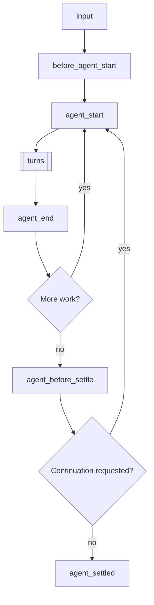
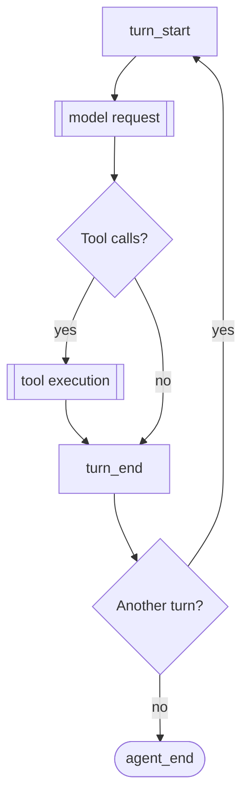
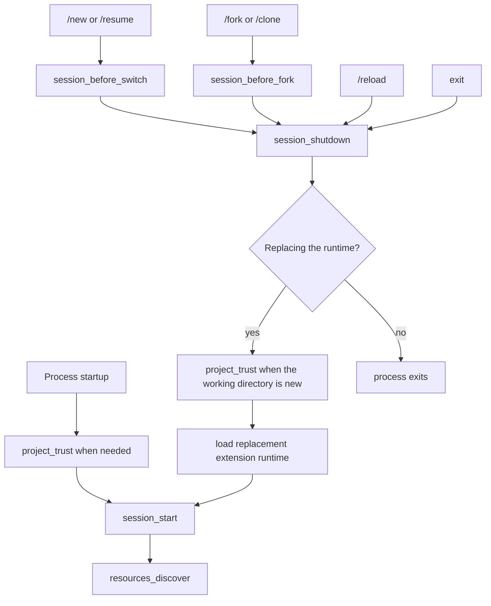

> Pi 可以创建扩展。你可以让它根据自己的场景构建一个扩展。

# 扩展

扩展是用于扩展 Pi 行为的 TypeScript 模块。它们可以订阅生命周期事件、注册 LLM 能够调用的自定义工具、添加命令，等等。

扩展在 Pi 进程内部运行，拥有相同的操作系统权限。它能够查看提示、工具调用、文件、凭据和会话历史，因此只应加载可信来源的扩展。

> **支持 /reload 的放置位置：** 将扩展放在 `~/.pi/agent/extensions/`（全局）或 `.pi/extensions/`（项目本地），即可自动发现。`pi -e ./path.ts` 只用于快速测试。自动发现位置中的扩展可以通过 `/reload` 热重载。

**主要能力：**
- **自定义工具** — 通过 `pi.registerTool()` 注册 LLM 可以调用的工具
- **事件拦截** — 阻止或修改工具调用、注入上下文、自定义压缩
- **用户交互** — 通过 `ctx.ui` 向用户发起选择、确认、输入和通知
- **自定义 UI 组件** — 通过 `ctx.ui.custom()` 使用支持键盘输入的完整 TUI 组件，实现复杂交互
- **自定义命令** — 通过 `pi.registerCommand()` 注册 `/mycommand` 等命令
- **会话持久化** — 通过 `pi.appendEntry()` 保存重启后仍然存在的状态
- **自定义渲染** — 控制工具调用／结果和消息在 TUI 中的呈现方式
- **提供商和 MCP Server** — 注册模型提供商、虚拟模型和 MCP Server

**使用场景示例：**
- 权限关卡，例如在执行 `rm -rf`、`sudo` 等命令前确认
- Git 检查点，例如每轮保存 stash，分支时恢复
- 路径保护，例如阻止写入 `.env`、`node_modules/`
- 自定义压缩，以自己的方式总结对话
- 对话摘要，见 `summarize.ts` 示例
- 交互式工具，例如问题、向导、自定义对话框
- 有状态工具，例如待办列表、连接池
- 外部集成，例如文件监听器、Webhook、CI 触发器
- 等待时玩游戏，见 `snake.ts` 示例

可运行的实现见 [examples/extensions/](../examples/extensions/)。

## 目录

- [快速开始](#quick-start)
- [扩展位置](#extension-locations)
- [可用导入](#available-imports)
- [编写扩展](#writing-an-extension)
  - [扩展组织方式](#extension-styles)
- [事件](#events)
  - [生命周期概览](#lifecycle-overview)
  - [处理器组合](#handler-composition)
  - [启动事件](#startup-events)
  - [资源事件](#resource-events)
  - [会话事件](#session-events)
  - [智能体事件](#agent-events)
  - [模型事件](#model-events)
  - [工具事件](#tool-events)
  - [用户 Bash 事件](#user-bash-events)
  - [输入事件](#input-events)
- [ExtensionContext](#extensioncontext)
- [ExtensionCommandContext](#extensioncommandcontext)
- [ExtensionAPI 方法](#extensionapi-methods)
- [状态管理](#state-management)
- [自定义工具](#custom-tools)
  - [工具暴露方式](#tool-exposure)
  - [调用其他工具](#calling-other-tools)
  - [动态加载工具](#dynamic-tool-loading)
- [MCP Server](#mcp-servers)
- [自定义 UI](#custom-ui)
- [错误处理](#error-handling)
- [模式行为](#mode-behavior)
- [示例参考](#examples-reference)

<a id="create-an-extension"></a>

## 快速开始

创建 `~/.pi/agent/extensions/my-extension.ts`：

```typescript
import { type ExtensionAPI, isToolCallEventType } from "@earendil-works/pi-coding-agent";
import { Type } from "typebox";

export default function (pi: ExtensionAPI) {
  // React to events
  pi.on("session_start", async (_event, ctx) => {
    ctx.ui.notify("Extension loaded!", "info");
  });

  pi.on("tool_call", async (event, ctx) => {
    if (isToolCallEventType("bash", event) && event.input.command.includes("rm -rf")) {
      const ok = await ctx.ui.confirm("Dangerous!", "Allow rm -rf?");
      if (!ok) return { block: true, reason: "Blocked by user" };
    }
  });

  // Register a custom tool
  pi.registerTool({
    name: "greet",
    label: "Greet",
    description: "Greet someone by name",
    parameters: Type.Object({
      name: Type.String({ description: "Name to greet" }),
    }),
    async execute(toolCallId, params, signal, onUpdate, ctx) {
      return {
        content: [{ type: "text", text: `Hello, ${params.name}!` }],
        details: {},
      };
    },
  });

  // Register a command
  pi.registerCommand("hello", {
    description: "Say hello",
    handler: async (args, ctx) => {
      ctx.ui.notify(`Hello ${args || "world"}!`, "info");
    },
  });
}
```

使用 `--extension`（或 `-e`）标记测试：

```bash
pi -e ./my-extension.ts
```

<a id="choose-where-it-loads"></a>

## 扩展位置

> **安全：** 扩展拥有你的全部系统权限，可以执行任意代码。只应安装来自可信来源的扩展。

Pi 从可信位置自动发现扩展。项目本地的 `.pi/extensions` 条目，只有在项目信任通过后才会加载。

| 位置 | 作用域 |
|----------|-------|
| `~/.pi/agent/extensions/*.ts` 或 `*.js` | 全局，适用于所有项目 |
| `~/.pi/agent/extensions/*/index.ts` 或 `index.js` | 全局，使用子目录 |
| `~/.pi/agent/extensions/*/package.json`，带有 `pi.extensions` 字段 | 全局，使用带清单的子目录 |
| `.pi/extensions/...` | 项目本地，布局规则相同 |

发现只深入一级目录。较大的包通过 `package.json` 清单声明入口点。

通过 `settings.json` 添加额外路径：

```json
{
  "packages": [
    "npm:@foo/bar@1.0.0",
    "git:github.com/user/repo@v1"
  ],
  "extensions": [
    "/path/to/local/extension.ts",
    "/path/to/local/extension/dir"
  ]
}
```

设置也接受以 `builtin:<name>` 条目表示的内置扩展，见[设置](settings.md#resources)。如果要通过 npm 或 git 将扩展作为 Pi 包共享，请参阅 [packages.md](packages.md)。

## 可用导入

| 包 | 用途 |
|---------|---------|
| `@earendil-works/pi-coding-agent` | 扩展类型，包括 `ExtensionAPI`、`ExtensionContext`、事件，以及辅助函数 |
| `@earendil-works/pi-agent-core` | 智能体消息和工具类型 |
| `typebox`、`typebox/compile`、`typebox/value` | 工具参数的 Schema 定义 |
| `@earendil-works/pi-ai` | AI 工具，包括用于字符串枚举的 `StringEnum`、转录记录辅助函数和模型类型 |
| `@earendil-works/pi-ai/compat`、`/models`、`/oauth`、`/providers/all` | 提供商构建、内置 API 和 OAuth 辅助函数 |
| `@earendil-works/pi-tui` | 自定义渲染使用的 TUI 组件 |

Pi 将这些导入映射到自己使用的副本，让扩展能够共享 Pi 的类和注册表。旧的 `@mariozechner/*` 与 `@sinclair/typebox` 名称也映射到相同模块。

也可以使用 npm 依赖。在扩展旁边或父目录中添加 `package.json`，运行 `npm install`，之后就会自动解析 `node_modules/` 中的导入。

通过 `pi install` 从 npm 或 git 安装分发的 Pi 包时，运行时依赖必须位于 `dependencies`；不会安装 `devDependencies`。不要将上面由宿主提供的包列入 `dependencies`。见[声明依赖](packages.md#declare-dependencies)。

也可以使用 Node.js 内置模块，例如 `node:fs`、`node:path` 等。

## 编写扩展

扩展默认导出一个接收 `ExtensionAPI` 的工厂函数。工厂可以同步，也可以异步：

```typescript
import type { ExtensionAPI } from "@earendil-works/pi-coding-agent";

export default function (pi: ExtensionAPI) {
  // Subscribe to events
  pi.on("event_name", async (event, ctx) => {
    // ctx.ui for user interaction
    const ok = await ctx.ui.confirm("Title", "Are you sure?");
    ctx.ui.notify("Done!", "info");
    ctx.ui.setStatus("my-ext", "Processing...");  // Footer status
    ctx.ui.setWidget("my-ext", ["Line 1", "Line 2"]);  // Widget above editor (default)
  });

  // Register tools, commands, shortcuts, flags
  pi.registerTool({ ... });
  pi.registerCommand("name", { ... });
  pi.registerShortcut("ctrl+x", { ... });
  pi.registerFlag("my-flag", { ... });
}
```

扩展通过 [jiti](https://github.com/unjs/jiti) 加载，因此无需编译即可使用 TypeScript。

如果工厂返回 `Promise`，Pi 会等待它完成，再继续启动。因此，异步初始化会在 `session_start`、`resources_discover` 以及通过 `pi.registerProvider()` 排队的提供商注册被提交之前完成。

### 异步工厂函数

获取远程配置、动态发现可用模型等一次性启动工作，适合使用异步工厂。

```typescript
import type { ExtensionAPI } from "@earendil-works/pi-coding-agent";

export default async function (pi: ExtensionAPI) {
  const response = await fetch("http://localhost:1234/v1/models");
  const payload = (await response.json()) as {
    data: Array<{
      id: string;
      name?: string;
      context_window?: number;
      max_tokens?: number;
    }>;
  };

  pi.registerProvider("local-openai", {
    baseUrl: "http://localhost:1234/v1",
    apiKey: "$LOCAL_OPENAI_API_KEY",
    api: "openai-completions",
    models: payload.data.map((model) => ({
      id: model.id,
      name: model.name ?? model.id,
      reasoning: false,
      input: ["text"],
      cost: { input: 0, output: 0, cacheRead: 0, cacheWrite: 0 },
      contextWindow: model.context_window ?? 128000,
      maxTokens: model.max_tokens ?? 4096,
    })),
  });
}
```

这种模式让获取的模型既可用于常规启动，也可用于 `pi --list-models`。对于在 Pi 运行期间变化的模型列表，应改为实现 `refreshModels`，见 [pi.registerProvider()](#piregisterprovidername-config)。

### 长期资源与关闭

扩展工厂可能在根本不会启动会话的调用中运行。不要从工厂中启动进程、套接字、文件监听器、定时器等后台资源。

应延迟到 `session_start`，或需要该资源的命令／工具／事件中再启动后台资源。注册幂等的 `session_shutdown` 处理器，关闭你启动的会话级资源。

### 扩展组织方式

**单文件** — 最简单，适合小型扩展：

```
~/.pi/agent/extensions/
└── my-extension.ts
```

**带 index.ts 的目录** — 适合多文件扩展：

```
~/.pi/agent/extensions/
└── my-extension/
    ├── index.ts        # Entry point (exports default function)
    ├── tools.ts        # Helper module
    └── utils.ts        # Helper module
```

**带依赖的包** — 适合需要 npm 包的扩展：

```
~/.pi/agent/extensions/
└── my-extension/
    ├── package.json    # Declares dependencies and entry points
    ├── package-lock.json
    ├── node_modules/   # After npm install
    └── src/
        └── index.ts
```

```json
// package.json
{
  "name": "my-extension",
  "dependencies": {
    "zod": "^3.0.0",
    "chalk": "^5.0.0"
  },
  "pi": {
    "extensions": ["./src/index.ts"]
  }
}
```

在扩展目录运行 `npm install`，之后 `node_modules/` 中的导入即可自动工作。

<a id="extension-events"></a>

## 事件

<a id="understand-the-lifecycle"></a>

### 生命周期概览

提示会启动一次运行。首先处理输入：

1. 扩展命令（`/name`）运行自己的处理器，不触发 `input` 事件。键入提示和 RPC 提示始终检查命令；`pi.sendUserMessage()` 仅在设置 `expandPromptTemplates: true` 时检查。
2. `input` 处理器可以拦截、转换或处理文本。
3. Skill 命令（`/skill:name`）和提示模板（`/template`）展开。
4. 运行 `before_agent_start`，随后启动智能体循环。

运行重复执行多个轮次，然后检查是否有更多工作需要启动下一次底层智能体运行：



更多工作包括重试、最终尝试恢复、压缩重试，或队列中的消息。因此，`agent_end` 不是最终空闲信号；应使用 `agent_settled`。被中止的运行会跳过 `agent_before_settle`，从 `agent_end` 直接进入 `agent_settled`。运行启动期间，包括压缩检查和 `before_agent_start`，Pi 都视为忙碌，因此期间发出的消息会进入正在启动的运行。

每个轮次发送一次模型请求，并执行 assistant 响应中的工具调用：



模型请求依次运行以下钩子：

1. `context`，可以修改对话消息
2. `context_with_system`，可以修改完整转录记录
3. `before_provider_headers`，可以修改请求头
4. `before_provider_request`，可以检查或替换载荷
5. `after_provider_response`，在读取流之前获取状态与响应头
6. `provider_stream_event`，获取已解析的原始流事件，以及 assistant 消息对应的 `message_start` / `message_update` / `message_end`

真正执行的工具调用依次运行以下钩子：

1. `tool_execution_start`
2. `tool_call`，可以阻止调用或修改输入
3. 工具执行期间的 `tool_execution_update`
4. `tool_result`，可以修改结果
5. `tool_execution_end`

不会执行的调用会提前结束。未知工具或无效参数会跳过 `tool_call`；被阻止或中止的调用会跳过执行和 `tool_result`。这些调用仍会收到带错误结果的 `tool_execution_end`，因此，要观测每个最终完成的调用，应使用 `tool_execution_end`。

`turn_end` 可以追加条目并请求继续。阈值压缩会在自然需要的下一轮之前运行。消息事件也会为其他消息触发，例如用户、工具结果及自定义消息。提供商钩子只在传输公开相应阶段时运行。

会话启动与替换遵循独立的生命周期：



`session_start` 携带 `reason: "startup" | "reload" | "new" | "resume" | "fork"`，`session_shutdown` 携带 `reason: "quit" | "reload" | "new" | "resume" | "fork"`。重载之后，`resources_discover` 使用 `reason: "reload"`；其他情况使用 `"startup"`。退出包括 Ctrl+C、Ctrl+D、SIGHUP 和 SIGTERM。`project_trust` 在加载可信项目资源前运行；会话替换进入新工作目录时，也可能再次运行。

其他一些操作会改变当前会话，但不替换运行时：

| 操作 | 事件 |
|---|---|
| `/compact` 或自动压缩 | `session_before_compact`，可取消或自定义，随后为 `session_compact` 或 `session_compact_failed` |
| `/tree` 导航 | `session_before_tree`，可取消或自定义，随后为 `session_tree` |
| `/name` 或 `pi.setSessionName()` | `session_info_changed` |
| `/model` 或模型轮换（`Ctrl+P`） | 如果级别变化或被限制，先触发 `thinking_level_select`，随后为 `model_select` |
| 思考级别更改，包括设置、按键绑定和 `pi.setThinkingLevel()` | `thinking_level_select` |
| `!` 或 `!!` 命令 | `user_bash`，可拦截 |
| 扩展对话框或自定义界面等待用户 | `ui_prompt_start`、`ui_prompt_end` |
| 空闲提示缓存刷新 | `cache_warming_decision` |
| 扩展在启动后注册或移除 MCP Server | `mcp_servers_change` |

<a id="events-and-concurrency"></a>
<a id="work-with-events"></a>

### 处理器组合

处理器先按扩展加载顺序，再按注册顺序运行。有些事件只通知，有些则转换数据、替换结果或取消操作：

| 模式 | 行为 |
|---|---|
| 通知 | 忽略返回值，只用于观测。 |
| 原位修改 | 后续处理器能够看到对 `before_provider_headers.headers`、`before_agent_start.systemPromptOptions`、`tool_call.input` 等值的修改。 |
| 链式转换 | 后续处理器接收先前 `input`、`context`、`context_with_system`、`message_end`、`tool_result` 和 `before_provider_request` 处理器返回的值。 |
| 关卡 | 已处理的输入、被阻止的工具调用、被取消的会话操作或已处理的 `user_bash` 命令，会停止该操作正常的后备路径。 |
| 可采取行动的边界 | 每个 `turn_end` 或 `agent_before_settle` 处理器都会看到此前提出的条目及继续决策。 |
| 最后覆盖 | 最后一个返回动作的 `cache_warming_decision` 处理器生效。 |

通知处理器不应在流式事件中执行缓慢工作。转换处理器应保留它们不打算管理的字段；关卡处理器无法作出安全决策时，应采用默认拒绝方式。

### 启动事件

#### project_trust

在 Pi 决定是否信任带动态配置（`.pi` 或 `.agents/skills`）的项目之前触发。它在启动时运行；会话替换，例如 `/resume`，进入一个尚未在当前进程中确定信任状态的 cwd 时也会运行。只有用户／全局扩展以及 CLI 的 `-e` 扩展参与；项目本地扩展要等信任状态确定之后才加载。

```typescript
pi.on("project_trust", async (event, ctx) => {
  // event.cwd - current working directory
  // ctx has a limited trust context: cwd, mode, hasUI, and select/confirm/input/notify UI helpers
  if (await ctx.ui.confirm("Trust project?", event.cwd)) {
    return { trusted: "yes", remember: true };
  }
  return { trusted: "undecided" };
});
```

`project_trust` 处理器必须返回 `{ trusted: "yes" | "no" | "undecided" }`。用户／全局或 CLI 扩展返回 `"yes"` 或 `"no"` 时，即接管决策；第一个 yes/no 决策生效，并抑制内置信任提示。使用 `remember: true` 持久保存 yes/no 决定，否则仅适用于当前进程。返回 `"undecided"`，让后续处理器或内置信任流程决定。提示用户前先检查 `ctx.hasUI`。没有处理器返回 yes/no 时，继续正常信任解析：先应用 `trust.json` 中保存的决定，再由 `defaultProjectTrust` 控制 Pi 默认是询问、信任还是拒绝。

### 资源事件

#### resources_discover

在 `session_start` 之后触发，让扩展能够添加额外的 Skill、提示和主题路径。
启动路径使用 `reason: "startup"`，重载使用 `reason: "reload"`。

```typescript
pi.on("resources_discover", async (event, _ctx) => {
  // event.cwd - current working directory
  // event.reason - "startup" | "reload"
  return {
    skillPaths: ["/path/to/skills"],
    promptPaths: ["/path/to/prompts"],
    themePaths: ["/path/to/themes"],
  };
});
```

#### mcp_servers_change

在扩展完成绑定后，如果扩展注册或注销 MCP Server，就会触发。`event.servers` 列出变更后全部已注册服务器。处理此事件，会将该扩展标记为负责连接已注册服务器的扩展，见 [MCP Server](#mcp-servers)。

### 会话事件

会话存储内部机制和 SessionManager API，见[会话格式](session-format.md)。

#### session_start

会话启动、加载或重载时触发。

```typescript
pi.on("session_start", async (event, ctx) => {
  // event.reason - "startup" | "reload" | "new" | "resume" | "fork"
  // event.previousSessionFile - present for "new", "resume", and "fork"
  ctx.ui.notify(`Session: ${ctx.sessionManager.getSessionFile() ?? "ephemeral"}`, "info");
});
```

#### session_info_changed

通过 `/name`、RPC 或 `pi.setSessionName()` 设置当前会话显示名称时触发。

```typescript
pi.on("session_info_changed", async (event, ctx) => {
  // event.name - current normalized name, or undefined if cleared
  ctx.ui.notify(`Session renamed: ${event.name ?? "(none)"}`, "info");
});
```

#### session_before_switch

开始新会话（`/new`）或切换会话（`/resume`）之前触发。

```typescript
pi.on("session_before_switch", async (event, ctx) => {
  // event.reason - "new" or "resume"
  // event.targetSessionFile - session we're switching to (only for "resume")

  if (event.reason === "new") {
    const ok = await ctx.ui.confirm("Clear?", "Delete all messages?");
    if (!ok) return { cancel: true };
  }
});
```

切换或新建会话操作成功后，Pi 为旧扩展实例发出 `session_shutdown`，为新会话重新加载并绑定扩展，随后发出带有 `reason: "new" | "resume"` 和 `previousSessionFile` 的 `session_start`。
应在 `session_shutdown` 中清理资源，再在 `session_start` 中重建内存状态。

#### session_before_fork

通过 `/fork` 分叉或通过 `/clone` 克隆时触发。

```typescript
pi.on("session_before_fork", async (event, ctx) => {
  // event.entryId - ID of the selected entry
  // event.position - "before" for /fork, "at" for /clone
  return { cancel: true }; // Cancel fork/clone
  // OR
  return { skipConversationRestore: true }; // Reserved for future conversation restore control
});
```

分叉或克隆成功后，Pi 为旧扩展实例发出 `session_shutdown`，为新会话重新加载并绑定扩展，随后发出带有 `reason: "fork"` 和 `previousSessionFile` 的 `session_start`。
应在 `session_shutdown` 中清理资源，再在 `session_start` 中重建内存状态。

<a id="session_before_compact--session_compact"></a>

#### session_before_compact / session_compact / session_compact_failed

压缩时触发，详情见 [compaction.md](compaction.md)。

```typescript
pi.on("session_before_compact", async (event, ctx) => {
  const { preparation, branchEntries, customInstructions, reason, willRetry, signal } = event;

  // reason - "manual" (/compact), "threshold", or "overflow"
  // willRetry - whether the aborted turn is retried after compaction (overflow recovery)

  // Cancel:
  return { cancel: true };

  // Custom summary:
  return {
    compaction: {
      summary: "...",
      firstKeptEntryId: preparation.firstKeptEntryId,
      tokensBefore: preparation.tokensBefore,
      // usage: summaryResponse.usage, // Optional; included in session totals
    }
  };
});

pi.on("session_compact", async (event, ctx) => {
  // event.compactionEntry - the saved compaction
  // event.fromExtension - whether extension provided it
  // event.reason - "manual" (/compact), "threshold", or "overflow"
  // event.willRetry - whether the aborted turn is retried after compaction (overflow recovery)
});

pi.on("session_compact_failed", async (event, ctx) => {
  // event.reason - "manual" (/compact), "threshold", or "overflow"
  // event.errorMessage - present for non-abort failures
  // event.aborted - true for cancelled/aborted compactions
  // event.willRetry - whether the aborted turn would have retried after compaction
  // event.fromExtension - whether extension-provided compaction content was being used
});
```

#### session_before_tree / session_tree

执行 `/tree` 导航时触发。树导航概念见[会话](sessions.md)。

```typescript
pi.on("session_before_tree", async (event, ctx) => {
  const { preparation, signal } = event;
  // preparation.targetId, oldLeafId, commonAncestorId, entriesToSummarize,
  // userWantsSummary, customInstructions, replaceInstructions, label
  return { cancel: true };
  // OR provide custom summary (used only when preparation.userWantsSummary is true):
  return {
    summary: {
      summary: "...",
      // usage: summaryResponse.usage, // Optional; included in session totals
      details: {},
    },
  };
  // OR override summarization options: customInstructions, replaceInstructions, label
});

pi.on("session_tree", async (event, ctx) => {
  // event.newLeafId, oldLeafId, summaryEntry, fromExtension
});
```

#### session_shutdown

已经启动的会话运行时即将销毁前触发。使用它清理由 `session_start` 或其他会话级钩子打开的资源。

```typescript
pi.on("session_shutdown", async (event, ctx) => {
  // event.reason - "quit" | "reload" | "new" | "resume" | "fork"
  // event.targetSessionFile - destination session for session replacement flows
  // Cleanup, save state, etc.
});
```

### 智能体事件

#### before_agent_start

在输入处理和展开完成之后、运行开始之前触发。可以注入消息和／或修改系统提示。

`event.messageType` 表明运行由什么启动：提示或 `pi.sendUserMessage()` 启动时为 `"user"`，带有 `prompt` 和 `images`；空闲时由 `pi.sendMessage(..., { triggerTurn: true })` 启动时为 `"custom"`，带有初始 `message`，没有 `prompt`。

```typescript
pi.on("before_agent_start", async (event, ctx) => {
  // event.messageType - "user" | "custom"
  // event.prompt, event.images - user's prompt text and images (messageType "user")
  // event.message - the custom message that starts the run (messageType "custom")
  // event.systemPrompt - current chained system prompt for this handler
  //   (includes changes from earlier before_agent_start handlers)
  // event.systemPromptOptions - structured options used to build the system prompt
  //   .customPrompt - exact prompt prefix from --system-prompt, SYSTEM.md, or custom templates
  //   .forceSystemPrompt - optional exact replacement for the complete prompt
  //   .selectedTools - tools currently active in the prompt
  //   .hiddenTools - selected tools whose declarations requests leave out
  //   .toolSnippets - one-line descriptions for each tool
  //   .toolGuidelines - rule bullets keyed by tool name
  //   .promptGuidelines - additional custom rule bullets
  //   .sections - custom XML-wrapped sections keyed by tag name
  //   .appendSystemPrompt - text from --append-system-prompt flags
  //   .cwd - working directory
  //   .contextFiles - AGENTS.md files and other loaded context files
  //   .skills - loaded skills

  return {
    // Inject a persistent message (stored in session, sent to LLM)
    message: {
      customType: "my-extension",
      content: "Additional context for the LLM",
      display: true,
    },
    // Replace the system prompt for this turn (chained across extensions)
    systemPrompt: event.systemPrompt + "\n\nExtra instructions for this turn...",
  };
});
```

返回的 `message` 会添加到任意一种运行中；如果要跳过自定义消息启动的运行，应检查 `messageType`。

`systemPromptOptions` 字段让扩展能够访问 Pi 构建系统提示时使用的同一组结构化数据，其中的集合可修改。优先修改 `sections`、`selectedTools` 或 `promptGuidelines`：Pi 将生成的提示章节与模型已有内容比较，只追加一条修补变更章节的系统消息。返回 `systemPrompt` 或设置 `forceSystemPrompt`，会替换该次运行的完整提示：每个提供商都将强制文本作为开头的系统提示接收，文本变化时会导致缓存未命中，而会话转录记录仍继续记载结构化章节。工具选择更改会同时更新提示贡献及提供给提供商执行的工具；在处理器内部调用 `pi.setActiveTools()`，效果与编辑 `selectedTools` 相同。支持对话中途系统消息的模型会原位接收补丁并保留缓存前缀；其他模型则将重放后的提示作为系统提示，每次变更产生一次缓存未命中。

在 `before_agent_start` 内，`event.systemPrompt` 和 `ctx.getSystemPrompt()` 都反映截至当前处理器的链式系统提示。后续 `before_agent_start` 处理器仍可再次修改。

<a id="agent_start--agent_end--agent_settled"></a>

#### agent_start / agent_end / agent_before_settle / agent_settled

底层智能体运行开始时触发 `agent_start`，结束时触发 `agent_end`，但 Pi 之后仍可能自动重试、自动压缩后重试，或继续处理队列中的后续消息。`agent_before_settle` 是最终可采取行动的边界，可以追加会话条目并请求一次继续。`agent_settled` 是最终的纯通知事件；需要确认 Pi 不会继续自动运行的状态集成，应使用它。

```typescript
pi.on("agent_start", async (_event, ctx) => {});

pi.on("agent_end", async (event, ctx) => {
  // event.messages - messages from this low-level run
});

let addedReviewReminder = false;
pi.on("agent_before_settle", async (event, ctx) => {
  if (addedReviewReminder) return;
  addedReviewReminder = true;
  return {
    entries: [...event.entries, {
      type: "custom_message",
      customType: "review-reminder",
      content: "Review the final diff before replying.",
      display: false,
    }],
    continue: true,
  };
});

pi.on("agent_settled", async (event, ctx) => {
  // event.aborted - true when the run ended because it was aborted, for example with Escape
  // ctx.isIdle() is true; runs requested here start after all settled handlers finish.
});
```

如果运行在 `agent_before_settle` 处理器执行期间被中止，有效的返回条目仍会提交，但请求的继续会被抑制。从 `agent_settled` 请求的工作会延迟到全部 settled 处理器完成之后，因此通知派发不会重入。

#### ui_prompt_start / ui_prompt_end

面向用户、会造成阻塞的扩展 UI 提示所使用的纯通知生命周期事件。它们在 `ctx.ui.select()`、`ctx.ui.confirm()`、`ctx.ui.input()`、`ctx.ui.editor()` 和 `ctx.ui.custom()` 的前后触发，让宿主／状态集成能够报告“等待用户”，而不只是“运行中”。

嵌套或重叠的提示会合并为一个外层等待区间。处理器以尽力而为的方式调用，显示或关闭提示前不会等待它们完成。

```typescript
pi.on("ui_prompt_start", async (event, ctx) => {
  // event.reason === "ui_prompt"
  // event.kind: "select" | "confirm" | "input" | "editor" | "custom"
  // event.title: prompt title when available
});

pi.on("ui_prompt_end", async (event, ctx) => {
  // Pi is no longer waiting on that UI prompt span.
});
```

#### turn_start / turn_end

每个轮次都会触发，即一次 LLM 响应及工具调用。

```typescript
pi.on("turn_start", async (event, ctx) => {
  // event.turnIndex, event.timestamp
});

let replacedResponse = false;
pi.on("turn_end", async (event, ctx) => {
  // event.turnIndex, event.message, event.toolResults
  // event.entries contains the structural entries proposed so far.
  if (replacedResponse || event.outcome !== "completed" || event.toolResults.length > 0) return;
  replacedResponse = true;
  return {
    entries: [
      ...event.entries,
      { type: "context_edit", targetId: event.messageEntryId, replacement: null },
      {
        type: "custom_message",
        customType: "replacement-instruction",
        content: "Answer again using the persisted user request.",
        display: false,
      },
    ],
    continue: true,
  };
});
```

`turn_end` 在 assistant 和工具结果消息持久化之后、底层 `turn_end` 事件之前运行。重试退避与最终尝试恢复仍然发生在 `agent_end` 之后，保留原有生命周期及队列顺序；这些工作完成后，`agent_before_settle` 看到的是修复后的投影。边界处理器按扩展加载和注册顺序运行。每个处理器通过 `event.entries` 看到此前的提议，并通过 `event.context` 看到根据它们重建的上下文。返回 `entries` 或 `continue` 只替换该字段；省略的字段保留当前提议。允许的条目草稿类型为 `custom`、`custom_message`、`context_edit` 和 `compaction`。所有处理器完成后，先校验完整提议，再按列表顺序追加；处理器错误会被报告，后续处理器仍会运行。校验能够避免语义错误只应用了一部分，但持久化并不是事务式的。

`continue: true` 确保当前边界调用之后有一次提供商请求。如果工具结果、引导消息或后续消息已经触发了该请求，就算满足这一决策，不会再额外请求；否则 Pi 发出一次仅上下文的请求。错误和中止响应仍然强制退出。`continue: false` 从不抑制自然产生的工作。应保护继续条件：无条件的 `continue: true` 会在下一次响应后再次求值，可能造成无限循环。`custom_message` 草稿会贡献一条 user 角色的模型消息，但它由扩展编写，不会运行人类输入钩子、斜杠命令、Skill 或提示模板。

构造 `TurnEndEvent` 值的宿主集成，必须提供 `messageEntryId`、`toolResultEntryIds`、`outcome`、`entries`、`continue` 和 `context`。对 `ExtensionEvent` 进行穷尽分支处理时，也必须处理 `agent_before_settle`。`ExtensionRunner.emit()` 排除了可采取行动的轮次边界；应通过 `emitBoundary(baseEvent, buildContext)` 派发 `turn_end` 和 `agent_before_settle`，让处理器获得链式预览。对于 `session_before_*` 等其他事件，专用 runner 方法仍返回结果。

#### message_start / message_update / message_end

消息生命周期更新时触发。

- 每条消息都会触发 `message_start` 和 `message_end`，包括用户、assistant、工具结果和自定义消息。
- assistant 流式更新会触发 `message_update`。
- `message_end` 处理器可以返回 `{ message }`，替换最终完成的消息，但必须保留相同的 `role`。

```typescript
pi.on("message_start", async (event, ctx) => {
  // event.message
});

pi.on("message_update", async (event, ctx) => {
  // event.message
  // event.assistantMessageEvent (token-by-token stream event)
});

pi.on("message_end", async (event, ctx) => {
  if (event.message.role !== "assistant") return;

  return {
    message: {
      ...event.message,
      usage: {
        ...event.message.usage,
        cost: {
          ...event.message.usage.cost,
          total: 0.123,
        },
      },
    },
  };
});
```

#### tool_execution_start / tool_execution_update / tool_execution_end

工具执行生命周期更新时触发。

在并行工具模式中：
- `tool_execution_start` 在预检阶段按 assistant 源顺序发出
- 不同工具的 `tool_execution_update` 事件可能交错
- 每个工具最终完成后，按完成顺序发出 `tool_execution_end`
- 最终 `toolResult` 消息事件仍在之后按 assistant 源顺序发出

```typescript
pi.on("tool_execution_start", async (event, ctx) => {
  // event.toolCallId, event.toolName, event.args
});

pi.on("tool_execution_update", async (event, ctx) => {
  // event.toolCallId, event.toolName, event.args, event.partialResult
});

pi.on("tool_execution_end", async (event, ctx) => {
  // event.toolCallId, event.toolName, event.result, event.isError
  // event.durationMs - milliseconds execute() took; absent when the tool did not run
});
```

如果调用由另一个工具发起，这三个事件以及 `tool_call`、`tool_result` 都会携带 `parentToolCallId`，见[调用其他工具](#calling-other-tools)。

#### context

每次 LLM 调用前触发。应以非破坏性方式修改消息。消息类型见[会话格式](session-format.md)。

```typescript
pi.on("context", async (event, ctx) => {
  // event.messages - deep copy without system messages, safe to modify
  const filtered = event.messages.filter(m => !shouldPrune(m));
  return { messages: filtered };
});
```

`event.messages` 包含不含系统消息的对话。提示和工具声明由 Pi 管理，不属于这个钩子：处理器返回更改后的列表时，Pi 会在返回消息之前，将当前提示章节和工具声明重放为一条开头的系统消息。因此，过滤、窗口化或从压缩摘要处切片，都不会丢失提示或工具。未更改的列表会保留对话中途系统消息，使支持这些消息的模型能够保留缓存前缀。处理器添加的系统消息，会保留在 Pi 的开头系统消息之后。要持久修改提示或工具集合，使用 [`before_agent_start`](#before_agent_start) 或 `pi.setActiveTools()`；要为单次请求编辑系统消息，使用 [`context_with_system`](#context_with_system)。

#### context_with_system

每次 LLM 调用前，在所有 `context` 处理器运行完毕、Pi 恢复提示和工具状态之后触发。`event.messages` 是完整转录记录，包含开头系统消息，以及任何对话中途的提示或工具补丁，见[会话格式](session-format.md#sessionmessageentry)。返回的消息会按原样发送：这个钩子负责该次请求的提示和工具声明。

```typescript
import { getCurrentSystemMessage } from "@earendil-works/pi-ai";

pi.on("context_with_system", async (event, ctx) => {
  const cut = findCutIndex(event.messages);
  // Fold the dropped prefix so its prompt and tool state survives as the new head.
  const head = getCurrentSystemMessage(event.messages.slice(0, cut));
  return { messages: head ? [head, ...event.messages.slice(cut)] : event.messages.slice(cut) };
});
```

规则：索引 0 必须保留一条系统消息，提供商从这里读取提示和初始工具声明；如果处理器将它删除，Pi 会报告错误。移除一条系统消息，也会移除它携带的工具声明和章节补丁。应使用 `@earendil-works/pi-ai` 的 `getCurrentSystemPrompt()` 和 `getCurrentTools()` 检查输出。处理器按扩展加载顺序运行；`before_agent_start` 强制指定的 `systemPrompt`，之后仍会投射到请求中。

#### before_provider_headers

出站 HTTP 请求头组装完成后触发。可用于添加、覆盖或移除请求头。

处理器原位修改 `event.headers`。将键设置为字符串，可以添加或覆盖；设为 `null` 则删除。

```typescript
pi.on("before_provider_headers", (event, ctx) => {
  // Add or override — e.g. a session id for gateway tracing/attribution
  event.headers["x-session-id"] = ctx.sessionManager.getSessionId();

  // Drop a tracking header pi adds for this call
  event.headers["X-OpenRouter-Title"] = null;
});
```

每次提供商请求运行一次；重试会复用相同请求头，而不会再次触发该钩子。

#### before_provider_request

提供商专用载荷构建完成、请求即将发出前触发。处理器按扩展加载顺序运行。返回 `undefined` 保持载荷不变，返回其他任意值则替换载荷，供后续处理器和实际请求使用。

这个钩子可以改写提供商层面的系统指令，或将其完全移除。载荷层面的这些变更不会反映在 `ctx.getSystemPrompt()` 中，后者报告 Pi 的系统提示字符串，而非最终序列化后的提供商载荷。

```typescript
pi.on("before_provider_request", (event, ctx) => {
  console.log(JSON.stringify(event.payload, null, 2));

  // Optional: replace payload
  // return { ...event.payload, temperature: 0 };
});
```

主要用于调试提供商序列化和缓存行为。

#### after_provider_response

收到 HTTP 响应之后、读取流式响应体之前触发。处理器按扩展加载顺序运行。

```typescript
pi.on("after_provider_response", (event, ctx) => {
  // event.status - HTTP status code
  // event.headers - normalized response headers
  if (event.status === 429) {
    console.log("rate limited", event.headers["retry-after"]);
  }
});
```

响应头是否可用，取决于提供商和传输。封装了 HTTP 响应的提供商可能不公开响应头。

#### provider_stream_event

Pi 规范化每个已解析的提供商流事件之前触发。只用于通知，不会持久化。

```typescript
pi.on("provider_stream_event", (event, ctx) => {
  // event.provider, event.api, event.model
  // event.data - earliest structured value available to Pi (read-only)
});
```

`event.data` 不一定是原始 HTTP 字节或 SSE 帧。应将其视为只读，因为修改它可能影响规范化。处理器按流顺序等待执行，因此缓慢的处理器会拖慢流的读取。处理器错误会被报告，但不会改变提供商响应。选择性启用、按 assistant 消息分组展示原始事件的查看器，见 [`debug-provider.ts`](../examples/extensions/debug-provider.ts)。

#### cache_warming_decision

每次提示缓存刷新之前触发，事件中已填入 Pi 的决策。它只携带 Pi 的费用估计；其他信息请使用 `ctx.model`、`ctx.isIdle()` 和 `ctx.getContextUsage()`。

```typescript
pi.on("cache_warming_decision", (event, ctx) => {
  // event.warmCost: price of this refresh
  // event.missCost: extra price of the next request if the entry is lost
  // event.continuationProbability: pi's estimate that a request arrives in time
  // event.action: "warm" | "stop", pi's decision

  if (ctx.model?.provider === "my-provider") {
    return { action: "stop" };
  }
});
```

返回 `{ action: "warm" }` 或 `{ action: "stop" }` 可以覆盖决策；最后一个返回动作的处理器生效。`"stop"` 会停止缓存保温，直到下一次真实请求。

### 模型事件

#### model_select

通过 `/model` 命令、模型轮换（`Ctrl+P`）或 `pi.setModel()` 切换模型时触发。恢复会话不会触发它；应在 `session_start` 中读取 `ctx.model`，初始化依赖模型的状态。

```typescript
pi.on("model_select", async (event, ctx) => {
  // event.model - newly selected model
  // event.previousModel - previous model (undefined if first selection)
  // event.source - "set" | "cycle"

  const prev = event.previousModel
    ? `${event.previousModel.provider}/${event.previousModel.id}`
    : "none";
  const next = `${event.model.provider}/${event.model.id}`;

  ctx.ui.notify(`Model changed (${event.source}): ${prev} -> ${next}`, "info");
});
```

活动模型变化时，可用它更新 UI 元素，例如状态栏、页脚，或执行模型专用初始化。

#### thinking_level_select

思考级别变化时触发。这是纯通知事件，处理器返回值会被忽略。

```typescript
pi.on("thinking_level_select", async (event, ctx) => {
  // event.level - newly selected thinking level
  // event.previousLevel - previous thinking level

  ctx.ui.setStatus("thinking", `thinking: ${event.level}`);
});
```

当 `pi.setThinkingLevel()`、模型切换或内置思考级别控件改变活动思考级别时，可用它更新扩展 UI。

<a id="tool-call-events"></a>

### 工具事件

#### tool_call

在 `tool_execution_start` 之后、工具执行之前触发。**可以阻止调用。** 使用 `isToolCallEventType` 进行类型收窄并取得类型化输入。

运行 `tool_call` 之前，Pi 会等待已发出的 Agent 事件经 `AgentSession` 处理完毕。因此，此时 `ctx.sessionManager` 已更新至当前包含工具调用的 assistant 消息。

在默认的并行工具执行模式中，同一 assistant 消息中的兄弟工具调用会依次预检，再并发执行。不保证 `tool_call` 能从 `ctx.sessionManager` 中看到同一 assistant 消息的兄弟工具结果。

`event.input` 可修改。原位修改它，可以在执行前修补工具参数。

行为保证：
- 对 `event.input` 的修改会影响实际工具执行
- 后续 `tool_call` 处理器能看到先前处理器的修改
- 修改之后不会重新校验
- `tool_call` 的返回值通过 `{ block: true, reason?: string, terminate?: boolean }` 控制阻止行为
- `terminate` 只适用于被阻止的调用；只有该批次每个最终结果都要求终止时，智能体才会提前停止

```typescript
import { isToolCallEventType } from "@earendil-works/pi-coding-agent";

pi.on("tool_call", async (event, ctx) => {
  // event.toolName - "bash", "read", "write", "edit", etc.
  // event.toolCallId
  // event.input - tool parameters (mutable)

  // Built-in tools: no type params needed
  if (isToolCallEventType("bash", event)) {
    // event.input is { command: string; timeout?: number }
    event.input.command = `source ~/.profile\n${event.input.command}`;

    if (event.input.command.includes("rm -rf")) {
      return { block: true, reason: "Dangerous command", terminate: true };
    }
  }

  if (isToolCallEventType("read", event)) {
    // event.input is { path: string; offset?: number; limit?: number }
    console.log(`Reading: ${event.input.path}`);
  }
});
```

#### 为自定义工具输入指定类型

自定义工具应导出自己的输入类型：

```typescript
// my-tool.ts
import { type Static, Type } from "typebox";

export const myToolSchema = Type.Object({ action: Type.String() });
export type MyToolInput = Static<typeof myToolSchema>;
```

为 `isToolCallEventType` 显式指定类型参数：

```typescript
import { isToolCallEventType } from "@earendil-works/pi-coding-agent";
import type { MyToolInput } from "./my-tool.ts";

pi.on("tool_call", (event) => {
  if (isToolCallEventType<"my_tool", MyToolInput>("my_tool", event)) {
    event.input.action;  // typed
  }
});
```

#### tool_result

工具执行完成后，在发出 `tool_execution_end` 和最终工具结果消息事件之前触发。**可以修改结果。**

在并行工具模式中，`tool_result` 和 `tool_execution_end` 可能按工具完成顺序交错，而最终 `toolResult` 消息事件仍在之后按 assistant 源顺序发出。

`tool_result` 处理器像中间件一样串联：
- 处理器按扩展加载顺序运行
- 每个处理器看到先前处理器修改后的最新结果
- 处理器可以返回部分补丁，即 `content`、`details`、`structuredContent`、`isError` 或 `usage`；省略的字段保持当前值
- 替换 `content` 却未返回 `structuredContent`，会丢弃结构化内容，因为它可能已不再匹配

在处理器内部启动嵌套异步工作时，使用 `ctx.signal`。这样，Esc 才能取消由扩展发起的模型调用、`fetch()` 及其他支持中止的操作。

```typescript
import { isBashToolResult } from "@earendil-works/pi-coding-agent";

pi.on("tool_result", async (event, ctx) => {
  // event.toolName, event.toolCallId, event.input, event.parentToolCallId
  // event.content, event.details, event.structuredContent, event.isError, event.usage

  if (isBashToolResult(event)) {
    // event.details is typed as BashToolDetails
  }

  const response = await fetch("https://example.com/summarize", {
    method: "POST",
    body: JSON.stringify({ content: event.content }),
    signal: ctx.signal,
  });

  // Modify result:
  return { content: [...], details: {...}, isError: false, usage: nestedModelUsage };
});
```

### 用户 Bash 事件

#### user_bash

用户执行 `!` 或 `!!` 命令时触发。**可以拦截。**

```typescript
import { createLocalBashOperations } from "@earendil-works/pi-coding-agent";

pi.on("user_bash", (event, ctx) => {
  // event.command - the bash command
  // event.excludeFromContext - true if !! prefix
  // event.cwd - working directory

  // Option 1: Provide custom operations (e.g., SSH)
  return { operations: remoteBashOps };

  // Option 2: Wrap pi's built-in local bash backend
  const local = createLocalBashOperations();
  return {
    operations: {
      exec(command, cwd, options) {
        return local.exec(`source ~/.profile\n${command}`, cwd, options);
      }
    }
  };

  // Option 3: Full replacement - return result directly
  return { result: { output: "...", exitCode: 0, cancelled: false, truncated: false } };
});
```

返回 `undefined` 会继续调用下一个处理器；如果都未处理，则在本地执行。有效结果会停止传播：`operations` 通过提供的后端执行命令，`result` 则记录已完成命令，而不再执行。

### 输入事件

#### input

收到用户输入时，在检查扩展命令之后、展开 Skill 和模板之前触发。事件看到的是原始输入文本，因此 `/skill:foo` 和 `/template` 尚未展开。

**处理顺序：**
1. 先检查扩展命令（`/cmd`）；找到则运行对应处理器，跳过 input 事件。来自 `pi.sendUserMessage()` 的消息只在设置 `expandPromptTemplates: true` 时检查。
2. 触发 `input` 事件，可以拦截、转换或处理
3. 如果未处理，将 Skill 命令（`/skill:name`）展开为 Skill 内容
4. 如果未处理，将提示模板（`/template`）展开为模板内容
5. 开始智能体处理，例如 `before_agent_start` 等

```typescript
pi.on("input", async (event, ctx) => {
  // event.text - raw input (before skill/template expansion)
  // event.images - attached images, if any
  // event.source - "interactive" (typed), "rpc" (API), or "extension" (via sendUserMessage)
  // event.streamingBehavior - "steer" | "followUp" | undefined
  //   undefined when idle, "steer" for mid-stream interrupts,
  //   "followUp" for messages queued until the agent finishes

  // Transform: rewrite input before expansion
  if (event.text.startsWith("?quick "))
    return { action: "transform", text: `Respond briefly: ${event.text.slice(7)}` };

  // Handle: respond without LLM (extension shows its own feedback)
  if (event.text === "ping") {
    ctx.ui.notify("pong", "info");
    return { action: "handled" };
  }

  // Route by source: skip processing for extension-injected messages
  if (event.source === "extension") return { action: "continue" };

  // Intercept skill commands before expansion
  if (event.text.startsWith("/skill:")) {
    // Could transform, block, or let pass through
  }

  return { action: "continue" };  // Default: pass through to expansion
});
```

**结果：**
- `continue` — 原样透传，处理器不返回值时的默认行为
- `transform` — 修改文本／图像，然后继续展开
- `handled` — 完全跳过智能体，第一个返回此值的处理器生效

转换会跨处理器串联。支持 `streamingBehavior` 的路由示例见 [input-transform.ts](../examples/extensions/input-transform.ts) 和 [input-transform-streaming.ts](../examples/extensions/input-transform-streaming.ts)。

<a id="use-extension-context"></a>

## ExtensionContext

所有处理器都接收 `ctx: ExtensionContext`。工具 `execute()` 接收 `ExtensionToolContext`，它额外提供 `ctx.tools` 和 `ctx.executeTool()`，见[调用其他工具](#calling-other-tools)。命令处理器则接收 [`ExtensionCommandContext`](#extensioncommandcontext)。

### ctx.ui

用于用户交互的 UI 方法。完整详情见[自定义 UI](#custom-ui)。

### ctx.mode

当前运行模式：`"tui"`、`"rpc"`、`"json"` 或 `"print"`。使用 `ctx.mode === "tui"` 保护仅限终端的功能，例如 `custom()`、组件工厂、终端输入和直接 TUI 渲染。

### ctx.hasUI

在 TUI 和 RPC 模式中为 `true`，在打印模式（`-p`）和 JSON 模式中为 `false`。用它保护在 TUI 和 RPC 模式中均可工作的对话框方法（`select`、`confirm`、`input`、`editor`），以及无需等待的方法（`notify`、`setStatus`、`setWidget`、`setTitle`、`setEditorText`）。在 RPC 模式中，一些 TUI 专用方法不执行操作，或返回默认值，见 [RPC 扩展 UI](rpc-extension-ui.md)。

### ctx.cwd

当前工作目录。

构造项目本地配置路径时，应使用 `CONFIG_DIR_NAME`，不要硬编码 `.pi`。重新命名的发行版可能使用不同的配置目录名。

```typescript
import { CONFIG_DIR_NAME, type ExtensionAPI } from "@earendil-works/pi-coding-agent";
import { join } from "node:path";

export default function (pi: ExtensionAPI) {
  pi.on("session_start", (_event, ctx) => {
    const projectConfigPath = join(ctx.cwd, CONFIG_DIR_NAME, "my-extension.json");
    // ...
  });
}
```

### ctx.isProjectTrusted()

返回当前会话上下文是否启用了项目本地信任。它包括临时信任决定及 CLI 信任覆盖，而不只是全局信任存储中保存的决定。

读取只应对可信项目生效的项目本地扩展配置前，先使用此方法检查。

### ctx.sessionManager

只读访问会话状态：`getCwd()`、`getSessionDir()`、`getSessionId()`、`getSessionFile()`、`getSessionName()`、`getHeader()`、`getEntries()`、`getEntry()`、`getBranch()`、`getTree()`、`getLeafId()`、`getLeafEntry()`、`getLabel()`、`buildContextEntries()` 和 `buildSessionProjection()`。条目类型见[会话格式](session-format.md)。

对于 `tool_call`，运行处理器之前，该状态已同步至当前 assistant 消息。并行工具执行模式下，仍不保证其中包含同一 assistant 消息中的兄弟工具结果。

```typescript
ctx.sessionManager.getEntries()             // All entries
ctx.sessionManager.getBranch()              // Current branch
ctx.sessionManager.buildContextEntries()    // Active branch entries with compaction applied
ctx.sessionManager.getLeafId()              // Current leaf entry ID
```

### ctx.modelRegistry / ctx.model / ctx.thinkingLevel / ctx.scopedModels

访问模型、提供商和已解析的身份验证信息。`ctx.modelRegistry.getProvider(id)` 返回有效的 pi-ai 提供商；`getProviderAuth(id)` 无需已加载模型，就能解析其当前 API Key、请求头、基础 URL 和提供商专用环境。`ctx.model` 是活动模型，`ctx.thinkingLevel` 是当前有效的思考级别。

`ctx.scopedModels` 是当前会话限定的只读模型列表，与 `/scoped-models` 命令显示的集合相同。会话启动时，根据 `--models` CLI 标记和 `enabledModels` 设置解析，通过 minimatch 将 `provider/modelId` 或单独的 `modelId` 与可用目录匹配。未配置范围时列表为空，表示所有可用模型都能使用。每个条目形如 `{ model, thinkingLevel? }`，其中 `thinkingLevel` 只在模式将它固定时设置，例如 `anthropic/*:high`。可以用它填充与内置模型选择器一致的选择界面，而不是通过 `ctx.modelRegistry.getAvailable()` 枚举整个目录。

#### 流式模型调用

要使用 `reasoning` 等提供商无关选项，应调用 `ctx.modelRegistry.streamSimple(model, context, options)`；要使用 API 专用选项并等待最终 assistant 消息，应调用 `complete(model, context, options)`。两者都使用已配置的提供商并解析身份验证，也能看到通过 `pi.registerProvider()` 注册的提供商。应使用它们，而不是无法看到扩展提供商注册的 `pi-ai/compat` 流式函数。

`streamSimple()` 返回 `AssistantMessageEventStream`。遍历它获取响应事件，再等待 `.result()` 获得最终消息。配置失败会产生错误事件与错误结果。

对于非聊天模型，`findOfType()`、`getModelsOfType()`、`getAvailableOfType()` 和 `getModelOfType()` 查找图像及分类器模型，`classify()` 和 `generateImages()` 则调用它们。见[使用分类器模型](models.md#use-classifier-models)和[使用图像模型](models.md#use-image-models)。

### ctx.signal

当前智能体中止信号；没有活动智能体轮次时为 `undefined`。

将它用于扩展处理器启动、支持中止的嵌套工作，例如：
- `fetch(..., { signal: ctx.signal })`
- 接受 `signal` 的模型调用
- 接受 `AbortSignal` 的文件或进程辅助函数

`ctx.signal` 通常在活动轮次事件中有值，例如 `tool_call`、`tool_result`、`message_update` 和 `turn_end`。
在空闲或非轮次上下文中，例如会话事件、扩展命令，以及 Pi 空闲时触发的快捷键，通常为 `undefined`。

```typescript
pi.on("tool_result", async (event, ctx) => {
  const response = await fetch("https://example.com/api", {
    method: "POST",
    body: JSON.stringify(event),
    signal: ctx.signal,
  });

  const data = await response.json();
  return { details: data };
});
```

### ctx.isIdle() / ctx.abort() / ctx.hasPendingMessages()

控制流辅助方法。Pi 正在处理智能体运行、自动重试、自动压缩重试或队列中的继续任务时，`ctx.isIdle()` 为 false。

### ctx.shutdown()

请求 pi 正常关闭。

- **交互模式：** 延迟到智能体空闲，也就是处理完所有排队的引导和后续消息之后。
- **RPC 模式：** 延迟到下一个空闲状态，即完成当前命令响应并等待下一条命令时。
- **打印模式：** 不执行操作。处理完所有提示后，进程会自动退出。

退出前向所有扩展发出 `session_shutdown` 事件。适用于全部上下文，包括事件处理器、工具、命令和快捷键。

```typescript
pi.on("tool_call", (event, ctx) => {
  if (isFatal(event.input)) {
    ctx.shutdown();
  }
});
```

### ctx.getContextUsage()

返回活动模型当前的上下文用量。有最近一次 assistant 用量时优先使用，再估算后续消息的 token 数。

```typescript
const usage = ctx.getContextUsage();
if (usage?.tokens != null && usage.tokens > 100_000) {
  // ...
}
```

### ctx.compact()

触发压缩，但不等待完成。后续操作应使用 `onComplete` 和 `onError`。

```typescript
ctx.compact({
  customInstructions: "Focus on recent changes",
  onComplete: (result) => {
    ctx.ui.notify("Compaction completed", "info");
  },
  onError: (error) => {
    ctx.ui.notify(`Compaction failed: ${error.message}`, "error");
  },
});
```

### ctx.getSystemPrompt()

返回 Pi 当前的系统提示字符串。

- 在 `before_agent_start` 期间，反映当前轮次截至目前的链式系统提示更改。
- 不包含之后的 `context` 消息修改。
- 不包含 `before_provider_request` 的载荷改写。
- 如果后加载的扩展在你的扩展之后运行，它们仍能改变最终发送的内容。

```typescript
pi.on("before_agent_start", (event, ctx) => {
  const prompt = ctx.getSystemPrompt();
  console.log(`System prompt length: ${prompt.length}`);
});
```

## ExtensionCommandContext

命令处理器接收 `ExtensionCommandContext`，它在 `ExtensionContext` 基础上增加会话控制方法。这些方法仅在命令中可用，因为从事件处理器调用可能死锁。

### ctx.getSystemPromptOptions()

返回 Pi 当前用于构建系统提示的基础输入。

```typescript
const options = ctx.getSystemPromptOptions();
const contextPaths = options.contextFiles?.map((file) => file.path) ?? [];
```

它与 `before_agent_start` 的 `event.systemPromptOptions` 具有相同的形状和可变性：自定义或强制提示、活动工具、工具片段、工具专用及自定义规则、自定义章节、追加提示文本、cwd、已加载上下文文件和 Skill。它可能包含完整的上下文文件内容，因此应将其视为扩展本地敏感数据，避免通过命令列表、日志或自动补全元数据公开。

这里报告的是当前基础提示输入，不包含每轮 `before_agent_start` 的链式系统提示更改、之后的 `context` 事件消息修改，或 `before_provider_request` 的载荷改写。

### ctx.waitForIdle()

等待智能体完全稳定下来，包括自动重试、自动压缩重试和队列中的继续任务：

```typescript
pi.registerCommand("my-cmd", {
  handler: async (args, ctx) => {
    await ctx.waitForIdle();
    // Agent is now idle, safe to modify session
  },
});
```

### ctx.newSession(options?)

创建新会话：

```typescript
const parentSession = ctx.sessionManager.getSessionFile();
const kickoff = "Continue in the replacement session";

const result = await ctx.newSession({
  parentSession,
  setup: async (sm) => {
    sm.appendMessage({
      role: "user",
      content: [{ type: "text", text: "Context from previous session..." }],
      timestamp: Date.now(),
    });
  },
  withSession: async (ctx) => {
    // Use only the replacement-session ctx here.
    await ctx.sendUserMessage(kickoff);
  },
});

if (result.cancelled) {
  // An extension cancelled the new session
}
```

选项：
- `parentSession`：要记录在新会话头中的父会话文件
- `setup`：在 `withSession` 运行前修改新会话的 `SessionManager`
- `withSession`：使用全新的替换会话上下文，执行切换后工作。不要使用捕获的旧 `pi`／命令 `ctx`；见[会话替换生命周期与易错点](#session-replacement-lifecycle-and-footguns)。

### ctx.fork(entryId, options?)

从指定条目分叉，创建新的会话文件：

```typescript
const result = await ctx.fork("entry-id-123", {
  withSession: async (ctx) => {
    // Use only the replacement-session ctx here.
    ctx.ui.notify("Now in the forked session", "info");
  },
});
if (result.cancelled) {
  // An extension cancelled the fork
}

const cloneResult = await ctx.fork("entry-id-456", { position: "at" });
if (cloneResult.cancelled) {
  // An extension cancelled the clone
}
```

选项：
- `position`：`"before"` 为默认值，在所选用户消息之前分叉，并将该提示恢复到编辑器
- `position`：`"at"` 复制经过所选条目的活动路径，不恢复编辑器文本
- `withSession`：使用全新的替换会话上下文，执行切换后工作。不要使用捕获的旧 `pi`／命令 `ctx`；见[会话替换生命周期与易错点](#session-replacement-lifecycle-and-footguns)。

### ctx.navigateTree(targetId, options?)

导航到会话树中的其他位置。智能体响应、手动或自动压缩，或另一次树导航正在进行时，会拒绝，即使设置了 `summarize: false`。发生这些冲突时，活动分支保持不变，Promise 会被拒绝，而不是返回 `{ cancelled: true }`。应等待当前操作完成，例如在命令处理器中使用 `await ctx.waitForIdle()`，然后重试。如果设置 `summarize` 却没有可用模型，或目标条目不存在，也会被拒绝：

```typescript
const result = await ctx.navigateTree("entry-id-456", {
  summarize: true,
  customInstructions: "Focus on error handling changes",
  replaceInstructions: false, // true = replace default prompt entirely
  label: "review-checkpoint",
});
```

选项：
- `summarize`：是否为放弃的分支生成摘要
- `customInstructions`：发送给摘要生成器的自定义指令
- `replaceInstructions`：为 true 时，`customInstructions` 替换默认提示，而不是追加
- `label`：附加到分支摘要条目的标签；不生成摘要时，则附加到目标条目

### ctx.switchSession(sessionPath, options?)

切换到其他会话文件：

```typescript
const result = await ctx.switchSession("/path/to/session.jsonl", {
  withSession: async (ctx) => {
    await ctx.sendUserMessage("Resume work in the replacement session");
  },
});
if (result.cancelled) {
  // An extension cancelled the switch via session_before_switch
}
```

选项：
- `withSession`：使用全新的替换会话上下文，执行切换后工作。不要使用捕获的旧 `pi`／命令 `ctx`；见[会话替换生命周期与易错点](#session-replacement-lifecycle-and-footguns)。

发现可用会话时，使用静态方法 `SessionManager.list()` 或 `SessionManager.listAll()`：

```typescript
import { SessionManager } from "@earendil-works/pi-coding-agent";

pi.registerCommand("switch", {
  description: "Switch to another session",
  handler: async (args, ctx) => {
    const sessions = await SessionManager.list(ctx.cwd);
    if (sessions.length === 0) return;
    const choice = await ctx.ui.select(
      "Pick session:",
      sessions.map((s) => s.path),
    );
    if (choice) {
      await ctx.switchSession(choice, {
        withSession: async (ctx) => {
          ctx.ui.notify("Switched session", "info");
        },
      });
    }
  },
});
```

### 会话替换生命周期与易错点

`withSession` 接收全新的 `ReplacedSessionContext`，它在 `ExtensionCommandContext` 基础上，增加绑定到替换会话的异步 `sendMessage()` 和 `sendUserMessage()` 辅助方法。

生命周期与易错点：
- 只有旧会话发出 `session_shutdown`、旧运行时已销毁、替换会话已重新绑定，且新扩展实例已经收到 `session_start` 后，才运行 `withSession`。
- 回调仍在原始闭包中执行，不在新扩展实例内部。因此，`withSession` 启动前，旧扩展实例可能已经执行关闭清理。
- 替换后，捕获的旧 `pi`／旧命令 `ctx` 中绑定会话的对象已经过期，使用时会抛出异常。会话相关工作只应使用传给 `withSession` 的 `ctx`。
- 先前提取出的原始对象，仍由你负责。例如，替换前捕获 `const sm = ctx.sessionManager`，`sm` 仍是旧的 `SessionManager` 对象。替换后不要复用。
- `withSession` 中的代码应假设：被你的 `session_shutdown` 处理器置为无效的状态已经不存在。只捕获能够安全跨越关闭过程的普通数据，例如字符串、ID 和序列化配置。

安全模式：

```typescript
pi.registerCommand("handoff", {
  handler: async (_args, ctx) => {
    const kickoff = "Continue from the replacement session";
    await ctx.newSession({
      withSession: async (ctx) => {
        await ctx.sendUserMessage(kickoff);
      },
    });
  },
});
```

不安全模式：

```typescript
pi.registerCommand("handoff", {
  handler: async (_args, ctx) => {
    const oldSessionManager = ctx.sessionManager;
    await ctx.newSession({
      withSession: async (_ctx) => {
        // stale old objects: do not do this
        oldSessionManager.getSessionFile();
        pi.sendUserMessage("wrong");
      },
    });
  },
});
```

### ctx.reload()

运行与 `/reload` 相同的重载流程。

```typescript
pi.registerCommand("reload-runtime", {
  description: "Reload extensions, skills, prompts, themes, and context files",
  handler: async (_args, ctx) => {
    await ctx.reload();
    return;
  },
});
```

重要行为：
- `await ctx.reload()` 为当前扩展运行时发出 `session_shutdown`
- 随后重新加载资源，并发出带有 `reason: "reload"` 的 `session_start`，以及原因是 `"reload"` 的 `resources_discover`
- 当前命令处理器仍在旧调用帧中继续执行
- `await ctx.reload()` 之后的代码仍来自重载前版本
- `await ctx.reload()` 之后的代码不能假设旧的内存扩展状态仍然有效
- 处理器返回后，后续命令、事件和工具调用才使用新扩展版本

为保持行为可预测，应将重载视为该处理器的终止操作，即 `await ctx.reload(); return;`。

工具使用 `ExtensionToolContext`，而不是 `ExtensionCommandContext`，因此不能调用 `ctx.reload()`，Pi 也无法在智能体运行期间重载。如果希望 LLM 触发重载，应让工具记录请求，再从 `agent_settled` 运行命令；该事件处理器发送的消息，会在所有 settled 处理器完成之后处理：

```typescript
let reloadRequested = false;

pi.registerTool({
  name: "reload_runtime",
  label: "Reload Runtime",
  description: "Reload extensions, skills, prompts, themes, and context files",
  parameters: Type.Object({}),
  async execute() {
    reloadRequested = true;
    return {
      content: [{ type: "text", text: "Reload requested. Pi reloads after this response." }],
      details: {},
      terminate: true,
    };
  },
});

pi.on("agent_settled", () => {
  if (!reloadRequested) return;
  reloadRequested = false;
  pi.sendUserMessage("/reload-runtime", { expandPromptTemplates: true });
});
```

`expandPromptTemplates: true` 将文本作为命令派发。未设置时，或使用 `deliverAs` 排队时，文本会作为普通用户消息到达模型。见 [reload-runtime.ts](../examples/extensions/reload-runtime.ts)。

## ExtensionAPI 方法

### pi.on(event, handler)

订阅事件。返回一个取消订阅函数，仅移除当前这次注册。事件类型和返回值见[事件](#events)。

```typescript
const unsubscribe = pi.on("agent_end", async (event) => {
  unsubscribe();
  await updateIntegration(event.messages);
});
```

处理器先按扩展加载顺序，再按每个扩展内部的注册顺序运行。添加或移除处理器，不会影响已经进行中的派发。

### pi.registerTool(definition)

注册 LLM 可以调用的自定义工具，完整详情见[自定义工具](#custom-tools)。

`pi.registerTool()` 在扩展加载期间和启动后都能使用，可以在 `session_start`、命令处理器或其他事件处理器中调用。新工具会在同一会话中立即刷新，无需 `/reload` 就会出现在 `pi.getAllTools()` 中。注册工具会激活它，除非设置 `defaultActive: false`，或者指定了不同于 `direct` 或 `model-only` 的[暴露方式](#tool-exposure)。

使用 `pi.setActiveTools()`，可在运行时启用或禁用工具，包括动态添加的工具。

为自定义工具设置 `promptSnippet`，可以让它以一行条目的形式出现在默认系统提示的 `<tools>` 章节；设置 `promptGuidelines`，则在工具活动时，将工具专用的项目符号追加到 `<rules>` 章节。

**重要：** `promptGuidelines` 中的项目符号会直接追加到 `<rules>` 章节，不带工具名称前缀。每条指南都必须写出对应工具的名称，避免“在……时使用此工具”，因为 LLM 无法判断“此工具”指哪一个。应改为“在……时使用 my_tool”。

完整示例见 [dynamic-tools.ts](../examples/extensions/dynamic-tools.ts)。

```typescript
import { Type } from "typebox";
import { StringEnum } from "@earendil-works/pi-ai";

pi.registerTool({
  name: "my_tool",
  label: "My Tool",
  description: "What this tool does",
  promptSnippet: "Summarize or transform text according to action",
  promptGuidelines: ["Use my_tool when the user asks to summarize previously generated text."],
  parameters: Type.Object({
    action: StringEnum(["list", "add"] as const),
    text: Type.Optional(Type.String()),
  }),

  async execute(toolCallId, params, signal, onUpdate, ctx) {
    // Stream progress; partial results also need details
    onUpdate?.({ content: [{ type: "text", text: "Working..." }], details: { result: "pending" } });

    return {
      content: [{ type: "text", text: "Done" }],
      details: { result: "..." },
    };
  },

  // Optional: Custom rendering
  renderCall(args, theme, context) { ... },
  renderResult(result, options, theme, context) { ... },
});
```

### pi.sendMessage(message, options?)

向会话注入自定义消息。自定义消息参与 LLM 上下文。对于需要持久化、仅用于 TUI 而不应发送给 LLM 的内容，使用 [`pi.appendEntry()`](#piappendentrycustomtype-data) 配合 [`pi.registerEntryRenderer()`](#piregisterentryrenderercustomtype-renderer)。

```typescript
pi.sendMessage({
  customType: "my-extension",
  content: "Message text",
  display: true,
  details: { ... },
}, {
  triggerTurn: true,
  deliverAs: "steer",
});
```

**选项：**
- `deliverAs` — 传递模式：
  - `"steer"` 为默认值，在流式输出时将消息排队；当前 assistant 轮次执行完工具调用后、下次 LLM 调用前传递。
  - `"followUp"` 等待智能体完成，只有没有更多工具调用时才传递。
  - `"nextTurn"` 排队等待下一条用户提示，不中断也不触发任何工作。
- `triggerTurn: true` — 如果智能体空闲，立即触发 LLM 响应。只适用于 `"steer"` 和 `"followUp"`，对 `"nextTurn"` 忽略。没有此选项时，空闲会话只保存消息，不启动轮次。
- 流式输出期间的 `triggerTurn: false` — 消息既不作为引导，也不作为后续消息排队，而是在当前轮次结束后追加。

### pi.sendUserMessage(content, options?)

向智能体发送用户消息。与发送自定义消息的 `sendMessage()` 不同，这会发送真正的用户消息，看起来如同用户键入。它会启动或排队一个轮次，除非输入被 `input` 处理器处理，或者在 `expandPromptTemplates: true` 下运行了扩展命令。

```typescript
// Simple text message
pi.sendUserMessage("What is 2+2?");

// With content array (text + images)
pi.sendUserMessage([
  { type: "text", text: "Describe this image:" },
  { type: "image", data: "...", mimeType: "image/png" },
]);

// During streaming - must specify delivery mode
pi.sendUserMessage("Focus on error handling", { deliverAs: "steer" });
pi.sendUserMessage("And then summarize", { deliverAs: "followUp" });

// Opt in to extension command dispatch and skill/prompt template expansion
pi.sendUserMessage("/review src/index.ts", { expandPromptTemplates: true });
```

**选项：**
- `deliverAs` — 智能体正在流式输出时必填：
  - `"steer"` 将消息排队，等当前 assistant 轮次执行完工具调用后传递
  - `"followUp"` 等待智能体完成全部工具
- `expandPromptTemplates` — 派发扩展命令，并展开 Skill 命令和提示模板，默认为 `false`。

没有流式输出时，消息立即发送并触发新轮次。正在流式输出却没有提供 `deliverAs` 时，消息会被拒绝，Pi 报告扩展错误。

完整示例见 [send-user-message.ts](../examples/extensions/send-user-message.ts)。

### pi.appendEntry(customType, data?)

持久保存扩展数据。自定义条目不参与 LLM 上下文。在交互模式中，配合 `pi.registerEntryRenderer()`，还可以将它们渲染在聊天转录记录中。

```typescript
pi.appendEntry("my-state", { count: 42 });
pi.appendEntry("status-card", { title: "Indexed files", count: 17 });

// Restore on reload
pi.on("session_start", async (_event, ctx) => {
  for (const entry of ctx.sessionManager.getEntries()) {
    if (entry.type === "custom" && entry.customType === "my-state") {
      // Reconstruct from entry.data
    }
  }
});
```

### pi.setSessionName(name)

设置会话显示名称，在会话选择器中代替首条消息显示。

```typescript
pi.setSessionName("Refactor auth module");
```

### pi.getSessionName()

获取已设置的当前会话名称。

```typescript
const name = pi.getSessionName();
if (name) {
  console.log(`Session: ${name}`);
}
```

### pi.setLabel(entryId, label)

设置或清除条目标签。标签是用户定义的标记，用于书签与导航，显示在 `/tree` 选择器中。

```typescript
// Set a label
pi.setLabel(entryId, "checkpoint-before-refactor");

// Clear a label
pi.setLabel(entryId, undefined);

// Read labels via sessionManager
const label = ctx.sessionManager.getLabel(entryId);
```

标签保存在会话中，重启后仍然存在。可以用它们标记对话树中的重要位置，例如轮次或检查点。

### pi.registerCommand(name, options)

注册命令。

多个扩展注册同名命令时，Pi 会全部保留，并按加载顺序分配数字调用后缀，例如 `/review:1` 和 `/review:2`。

```typescript
pi.registerCommand("stats", {
  description: "Show session statistics",
  handler: async (args, ctx) => {
    const count = ctx.sessionManager.getEntries().length;
    ctx.ui.notify(`${count} entries`, "info");
  }
});
```

可选：为 `/command ...` 添加参数自动补全。`getArgumentCompletions` 也可以返回 `Promise`：

```typescript
import type { AutocompleteItem } from "@earendil-works/pi-tui";

pi.registerCommand("deploy", {
  description: "Deploy to an environment",
  getArgumentCompletions: (prefix: string): AutocompleteItem[] | null => {
    const envs = ["dev", "staging", "prod"];
    const items = envs.map((e) => ({ value: e, label: e }));
    const filtered = items.filter((i) => i.value.startsWith(prefix));
    return filtered.length > 0 ? filtered : null;
  },
  handler: async (args, ctx) => {
    ctx.ui.notify(`Deploying: ${args}`, "info");
  },
});
```

### pi.getCommands()

获取当前会话中可以通过 `prompt` 调用的斜杠命令，包括扩展命令、提示模板和 Skill 命令。
列表与 RPC `get_commands` 的顺序一致：先扩展，再模板，最后 Skill。Skill 命令命名为 `skill:<name>`。

```typescript
const commands = pi.getCommands();
const bySource = commands.filter((command) => command.source === "extension");
const userScoped = commands.filter((command) => command.sourceInfo.scope === "user");
```

每个条目形如：

```typescript
{
  name: string; // Invokable command name without the leading slash. May be suffixed like "review:1"
  description?: string;
  source: "extension" | "prompt" | "skill";
  sourceInfo: {
    path: string;
    source: string;
    scope: "user" | "project" | "temporary";
    origin: "package" | "top-level";
    baseDir?: string;
  };
}
```

以 `sourceInfo` 作为规范的来源字段。不要根据命令名称或临时路径解析来推断归属。

内置交互命令，例如 `/model` 和 `/settings`，不包含在这里。它们只在交互模式中处理，通过 `prompt` 发送不会执行。

### pi.registerMessageRenderer(customType, renderer)

为具有指定 `customType` 的自定义消息注册 TUI 渲染器。自定义消息由 `pi.sendMessage()` 创建，参与 LLM 上下文。见[自定义 UI](#custom-ui)。

### pi.registerMarkdownTransformer(transformer)

为普通用户文本、assistant 文本和思考块中的 Markdown 注册转换器。转换器按扩展加载顺序运行，每个转换器接收上一个转换器返回的 Markdown。整条链结束后，Pi 使用内置渲染器渲染转换后的内容。

转换器接收 Markdown 字符串，以及包含以下字段的上下文：

- `messageType` — `"user"`、`"assistant"` 或 `"assistant-thinking"`
- `isStreaming` — assistant 部分更新时为 `true`；用户消息、最终完成的 assistant 消息和恢复的消息为 `false`
- `availableWidth` — 转换后 Markdown 内容实际可用的终端列数
- `messageId`、`timestamp` — 从持久化会话条目渲染时的会话条目 ID 和 ISO 时间戳；实时消息中为 `undefined`

返回转换后的 Markdown：

```typescript
pi.registerMarkdownTransformer((markdown, { messageType, isStreaming }) => {
  if (isStreaming || messageType === "assistant-thinking") return markdown;
  return markdown.replaceAll("-->", "→");
});
```

转换器抛出异常时，Pi 保留截至目前生成的 Markdown，继续运行下一个转换器。这个钩子只影响显示，原消息在会话和模型上下文中保持不变。新用户消息、assistant 流式更新、恢复的会话消息以及终端宽度变化都会触发它，因此转换器应保持同步且开销较低。

### pi.registerEntryRenderer(customType, renderer)

为具有指定 `customType` 的自定义条目注册 TUI 渲染器。自定义条目由 `pi.appendEntry()` 创建，不参与 LLM 上下文。

```typescript
import { Box, Text } from "@earendil-works/pi-tui";

pi.registerEntryRenderer("status-card", (entry, { expanded }, theme) => {
  const data = entry.data as { title: string; count: number };
  const box = new Box(1, 1, (text) => theme.bg("customMessageBg", text));
  box.addChild(new Text(`${theme.bold(data.title)}: ${data.count}`));
  if (expanded) {
    box.addChild(new Text(theme.fg("dim", JSON.stringify(data, null, 2))));
  }
  return box;
});

pi.appendEntry("status-card", { title: "Indexed files", count: 17 });
```

### pi.registerShortcut(shortcut, options)

注册键盘快捷键。快捷键格式和内置按键绑定见 [keybindings.md](keybindings.md)。

```typescript
pi.registerShortcut("ctrl+shift+p", {
  description: "Toggle plan mode",
  handler: async (ctx) => {
    ctx.ui.notify("Toggled!");
  },
});
```

### pi.registerFlag(name, options)

注册 CLI 标记。

```typescript
pi.registerFlag("plan", {
  description: "Start in plan mode",
  type: "boolean",
  default: false,
});

// Check the value after loading; in the factory, getFlag() returns the default
pi.on("session_start", () => {
  if (pi.getFlag("plan")) {
    // Plan mode enabled
  }
});
```

### pi.exec(command, args, options?)

执行 Shell 命令。

```typescript
const result = await pi.exec("git", ["status"], { signal, timeout: 5000 });
// result.stdout, result.stderr, result.code, result.killed
```

### pi.getActiveTools() / pi.getAllTools() / pi.setActiveTools(names)

管理活动工具，适用于内置工具与动态注册的工具。`pi.getActiveTools()` 返回活动工具名称，类型为 `string[]`；`pi.getAllTools()` 返回全部已配置工具的元数据。

```typescript
const active = pi.getActiveTools(); // ["read", "bash", ...]
const all = pi.getAllTools();
// all = [{
//   name: "read",
//   description: "Read file contents...",
//   parameters: ...,
//   promptGuidelines: ["Use read to examine files instead of cat or sed."],
//   exposure: "direct",
//   sourceInfo: { path: "builtin:read", source: "builtin", scope: "temporary", origin: "top-level" }
// }, ...]
// Tools shipped with Pi: core tools and tools from built-in extensions such as builtin:mcp
const shippedTools = all.filter((t) => t.sourceInfo.source === "builtin");
// Tools from installed or local extensions
const extensionTools = all.filter((t) => t.sourceInfo.source !== "builtin" && t.sourceInfo.source !== "sdk");
pi.setActiveTools([...new Set([...active, "my_custom_tool"])]); // Keep current tools and enable my_custom_tool
pi.setActiveTools(["read", "bash"]); // Only read and bash
```

`pi.getAllTools()` 返回 `name`、`description`、`parameters`、`promptGuidelines`、`exposure`、`sourceInfo`，以及已设置时的 `namespace`、`annotations` 和 `reachesTools`。

常见 `sourceInfo` 值：
- Pi 自带工具使用 `source: "builtin"`，包括核心工具（`path: "builtin:<tool>"`），以及由 `builtin:mcp` 等内置扩展注册的工具（`path: "builtin:<extension>"`）
- 通过 `createAgentSession({ customTools })` 传入的工具使用 `source: "sdk"`
- 扩展注册的工具使用扩展来源元数据

`pi.setActiveTools()` 忽略未知及 `hidden` 工具。暴露方式为 `codemode` 或 `deferred` 的工具，不论是否活动，都可以从 codemode 脚本中调用。

### pi.setModel(model)

为当前会话设置模型。变更会记录到会话历史，并在恢复会话时还原，但不会修改新会话使用的 `defaultProvider` 或 `defaultModel` 配置。如果没有为模型提供商配置身份验证，返回 `false`。自定义模型配置见 [models.md](models.md)。

```typescript
const model = ctx.modelRegistry.find("anthropic", "claude-sonnet-4-5");
if (model) {
  const success = await pi.setModel(model);
  if (!success) {
    ctx.ui.notify("No API key for this model", "error");
  }
}
```

### pi.getThinkingLevel() / pi.setThinkingLevel(level)

获取当前思考级别。级别会限制在模型能力范围内，非推理模型始终使用 "off"。更改会发出 `thinking_level_select`。

`pi.setThinkingLevel()` 更改当前会话的思考级别。变更会记录到会话历史，并在恢复会话时还原，但不会修改新会话使用的默认配置。

```typescript
const current = pi.getThinkingLevel();  // "off" | "minimal" | "low" | "medium" | "high" | "xhigh" | "max"
pi.setThinkingLevel("high");
```

### pi.events

供扩展之间通信的共享事件总线：

```typescript
pi.events.on("my:event", (data) => { ... });
pi.events.emit("my:event", { ... });
```

### pi.registerProvider(name, config)

动态注册或覆盖模型提供商，适用于代理、自定义端点或团队统一模型配置。

扩展工厂函数期间发起的调用会排队，在 runner 初始化后统一应用。之后的调用，例如用户设置流程结束后从命令处理器发起的调用，会立即生效，无需 `/reload`。

动态提供商可以实现 `refreshModels`。Pi 在模型刷新期间调用它，通过提供商同步发布返回列表，并传入规范的凭据／已存储目录／网络／信号上下文。扩展自行决定是否通过带生成代次检查的 `context.publish({ persist: entry })` 持久保存目录元数据；llama.cpp 等实时服务器可以返回模型而不持久化。

`context.signal` 始终是一个实际信号，提供商回调必须将其传给阻塞 I/O。公开的 `ModelRuntime.refresh()` 和 `ModelRegistry.refresh()` 接受可选信号；省略时没有时间边界，扩展和应用自行选择截止时间。即使提供商忽略信号，取消仍能让调用方停止等待；但要停止底层工作，仍需提供商配合。

需要原生提供商身份验证、过滤、刷新或流行为的扩展，可以注册来自 `@earendil-works/pi-ai` 的完整 `Provider`。该提供商成为组合的基础，`models.json` 覆盖仍在其上应用。

```typescript
import { createProvider, openAICompletionsApi } from "@earendil-works/pi-ai/compat";

const provider = createProvider({
  id: "local-server",
  name: "Local Server",
  baseUrl: "http://localhost:8080/v1",
  auth: {
    apiKey: {
      name: "Local server setup",
      async login(interaction) {
        return {
          type: "api_key",
          key: await interaction.prompt({ type: "secret", message: "API key" }),
        };
      },
      async resolve({ credential }) {
        return credential?.key
          ? { auth: { apiKey: credential.key }, source: "stored API key" }
          : undefined;
      },
    },
  },
  models: [],
  api: openAICompletionsApi(),
});

pi.registerProvider(provider);

// Register a new provider with custom models
pi.registerProvider("my-proxy", {
  name: "My Proxy",
  baseUrl: "https://proxy.example.com",
  apiKey: "$PROXY_API_KEY",  // env var reference
  api: "anthropic-messages",
  models: [
    {
      id: "claude-sonnet-4-20250514",
      name: "Claude 4 Sonnet (proxy)",
      reasoning: false,
      input: ["text", "image"],
      cost: { input: 0, output: 0, cacheRead: 0, cacheWrite: 0 },
      contextWindow: 200000,
      maxTokens: 16384
    }
  ]
});

// Register a live llama.cpp catalog without persisting discovered models
pi.registerProvider("llama.cpp", {
  baseUrl: "http://localhost:8080/v1",
  apiKey: "local",
  api: "openai-completions",
  async refreshModels({ signal }) {
    const response = await fetch("http://localhost:8080/v1/models", { signal });
    const { data } = (await response.json()) as { data: Array<{ id: string }> };
    return data.map(({ id }) => ({
      id,
      name: id,
      reasoning: false,
      input: ["text"],
      cost: { input: 0, output: 0, cacheRead: 0, cacheWrite: 0 },
      contextWindow: 128000,
      maxTokens: 16384
    }));
  }
});

// Override baseUrl for an existing provider (keeps all models)
pi.registerProvider("anthropic", {
  baseUrl: "https://proxy.example.com"
});

// Register provider with OAuth support for /login
pi.registerProvider("corporate-ai", {
  baseUrl: "https://ai.corp.com",
  api: "openai-responses",
  models: [...],
  oauth: {
    name: "Corporate AI (SSO)",
    async login(callbacks) {
      // Custom OAuth flow
      callbacks.onAuth({ url: "https://sso.corp.com/..." });
      const code = await callbacks.onPrompt({ message: "Enter code:" });
      return { refresh: code, access: code, expires: Date.now() + 3600000 };
    },
    async refreshToken(credentials, signal) {
      signal.throwIfAborted();
      // Refresh logic
      return credentials;
    },
    getApiKey(credentials) {
      return credentials.access;
    }
  }
});
```

对象形式接受完整的 pi-ai `Provider`，包含原生 `auth`、`getModels`、`refreshModels`、`filterModels`、`stream` 和 `streamSimple` 行为。

**旧式配置选项：**
- `name` — 提供商在 `/login` 等 UI 中的显示名称。
- `baseUrl` — API 端点 URL。每个已定义模型都需要它，可以来自模型定义或提供商。
- `apiKey` — API Key 字面值、环境变量插值（`$ENV_VAR` 或 `${ENV_VAR}`），或以 `!command` 开头的命令。可选；没有时，用户通过 `/login` 保存密钥。`$$` 转义 `$`，`$!` 转义字面的 `!`，不触发命令执行。
- `api` — API 类型，例如 `"anthropic-messages"`、`"openai-completions"`、`"openai-responses"` 等。
- `headers` — 请求中包含的自定义请求头。
- `authHeader` — 为 true 时，自动添加 `Authorization: Bearer` 请求头。
- `models` — 模型定义数组。如果提供，将替换该提供商全部现有模型。模型定义可以设置 `baseUrl`，覆盖该模型使用的提供商端点。
- `refreshModels` — 异步动态发现回调。它返回的模型替换扩展提供的模型。`context.stored` 包含持久化提供商快照；只有更新后的目录数据需要持久化时，才使用带生成代次检查的 `context.publish({ persist: entry })`。使用 `persist: null` 删除快照。
- `oauth` — 支持 `/login` 的 OAuth 提供商配置。提供后，该提供商会出现在登录菜单中。
- `streamSimple` — 面向非标准 API 的自定义流式传输实现。

自定义流式 API、OAuth 细节及模型定义参考等进阶主题，见 [custom-provider.md](custom-provider.md)。

### pi.unregisterProvider(name)

移除先前注册的提供商及其模型，被其覆盖的内置模型会恢复。如果提供商未注册，则不产生影响。

与 `registerProvider` 一样，在初始加载阶段之后调用会立即生效，无需 `/reload`。

```typescript
pi.registerCommand("my-setup-teardown", {
  description: "Remove the custom proxy provider",
  handler: async (_args, _ctx) => {
    pi.unregisterProvider("my-proxy");
  },
});
```

### pi.registerVirtualModel(model) / pi.unregisterVirtualModel(provider, id)

注册可供选择的目录条目，将每次请求路由到物理模型。`ctx.model` 及会话模型选择指向虚拟模型；assistant 消息则记录路由器选择的物理模型和思考级别。再次注册相同提供商和 ID，会替换该虚拟模型。见[虚拟模型](virtual-models.md)。

### pi.registerMcpServer(name, config) / pi.unregisterMcpServer(name) / pi.getMcpServers()

为当前会话注册 MCP Server，见 [MCP Server](#mcp-servers)。

### pi.registerToolRenderer(resolver)

选择任意工具调用的绘制方式，也包括尚未注册的工具，例如恢复会话中、服务器还未连接时的 MCP 工具。解析器接收工具名称和 `next()`；后者返回余下解析器按扩展加载顺序处理后，再由已注册工具决定的渲染方式，因此 `next() ?? mine` 只会补充缺省项。

```typescript
pi.registerToolRenderer((toolName, next) => {
  if (!toolName.startsWith("mcp__")) return next();
  return next() ?? { renderCall: (args, theme) => new Text(theme.fg("toolTitle", toolName), 0, 0) };
});
```

### pi.getSettings()

返回有效设置的副本，其中全局和项目设置已经合并，并应用了覆盖配置。

<a id="persist-state"></a>

## 状态管理

带状态的扩展应将状态保存在工具结果的 `details` 中，以正确支持分支：

```typescript
export default function (pi: ExtensionAPI) {
  let items: string[] = [];

  // Reconstruct state from the active branch
  const reconstruct = (ctx: ExtensionContext) => {
    items = [];
    for (const entry of ctx.sessionManager.getBranch()) {
      if (entry.type === "message" && entry.message.role === "toolResult") {
        if (entry.message.toolName === "my_tool") {
          items = (entry.message.details as { items?: string[] } | undefined)?.items ?? [];
        }
      }
    }
  };
  pi.on("session_start", async (_event, ctx) => reconstruct(ctx));
  pi.on("session_tree", async (_event, ctx) => reconstruct(ctx)); // /tree changes the branch

  pi.registerTool({
    name: "my_tool",
    // ...
    async execute(toolCallId, params, signal, onUpdate, ctx) {
      items.push("new item");
      return {
        content: [{ type: "text", text: "Added" }],
        details: { items: [...items] },  // Store for reconstruction
      };
    },
  });
}
```

应从 `getBranch()` 重建，而非使用全部条目，因为被放弃的分支代表其他历史路径。不应传给模型的持久数据，使用 [`pi.appendEntry()`](#piappendentrycustomtype-data)。

<a id="register-tools"></a>

## 自定义工具

通过 `pi.registerTool()` 注册 LLM 可调用的工具。工具会出现在系统提示中，也可以自定义渲染。

使用 `promptSnippet`，在默认系统提示的 `<tools>` 章节中提供一条简短单行说明。省略时，自定义工具不会出现在该章节。

使用 `promptGuidelines`，将工具专用项目符号添加到默认系统提示的 `<rules>` 章节。这些项目符号只在工具活动时包含，例如调用 `pi.setActiveTools([...])` 之后。

**重要：** `promptGuidelines` 中的项目符号会平铺追加到 `<rules>` 章节，不带工具名称前缀或分组。每条指南都必须写出对应工具的名称，避免“在……时使用此工具”，因为 LLM 无法判断“此工具”指哪一个。应改为“在……时使用 my_tool”。

注意：某些模型会在工具路径参数中加入 @ 前缀。内置工具在解析路径前会移除开头的 @。如果自定义工具接受路径，也应规范化开头的 @。

如果自定义工具修改文件，应使用 `withFileMutationQueue()`，使它参与内置 `edit` 和 `write` 使用的同一个逐文件队列。这很重要，因为工具调用默认并行运行。未加入队列时，两个工具可能读取相同的旧文件内容、计算不同更新，然后最后一次写入覆盖另一个工具的结果。

失败示例：同一 assistant 轮次中，自定义工具编辑 `foo.ts`，内置 `edit` 也修改 `foo.ts`。如果自定义工具未加入队列，两者都可能读取原始 `foo.ts`，分别应用更改，最终其中一项更改丢失。

应向 `withFileMutationQueue()` 传入实际目标文件路径，而不是原始用户参数。先相对于 `ctx.cwd` 或工具工作目录解析为绝对路径。对于现有文件，辅助函数通过 `realpath()` 规范化，因此指向同一文件的符号链接别名共享队列。对于新文件，由于还无法执行 `realpath()`，则回退到已解析的绝对路径。

应将该目标路径上的整个修改区间放入队列，包括读取—修改—写入逻辑，而不只是最后写入。

```typescript
import { withFileMutationQueue } from "@earendil-works/pi-coding-agent";
import { mkdir, readFile, writeFile } from "node:fs/promises";
import { dirname, resolve } from "node:path";

async execute(_toolCallId, params, _signal, _onUpdate, ctx) {
  const absolutePath = resolve(ctx.cwd, params.path);

  return withFileMutationQueue(absolutePath, async () => {
    await mkdir(dirname(absolutePath), { recursive: true });
    const current = await readFile(absolutePath, "utf8");
    const next = current.replace(params.oldText, params.newText);
    await writeFile(absolutePath, next, "utf8");

    return {
      content: [{ type: "text", text: `Updated ${params.path}` }],
      details: {},
    };
  });
}
```

### 工具定义

```typescript
import { type Static, Type } from "typebox";
import { StringEnum } from "@earendil-works/pi-ai";

const myToolSchema = Type.Object({
  action: StringEnum(["list", "add"] as const),
  text: Type.Optional(Type.String()),
});

pi.registerTool({
  name: "my_tool",
  label: "My Tool",
  description: "What this tool does (shown to LLM)",
  promptSnippet: "List or add items in the project todo list",
  promptGuidelines: [
    "Use my_tool for todo planning instead of direct file edits when the user asks for a task list."
  ],
  parameters: myToolSchema,
  prepareArguments(args) {
    // Fold a legacy `oldAction` field into `action`. Schema validation still runs afterwards.
    const input = (args ?? {}) as { action?: unknown; oldAction?: unknown };
    if (input.action === undefined && input.oldAction !== undefined) {
      return { ...input, action: input.oldAction } as Static<typeof myToolSchema>;
    }
    return args as Static<typeof myToolSchema>;
  },

  async execute(toolCallId, params, signal, onUpdate, ctx) {
    // Check for cancellation
    if (signal?.aborted) {
      return { content: [{ type: "text", text: "Cancelled" }], details: {} };
    }

    // Stream progress updates; partial results also need details
    onUpdate?.({
      content: [{ type: "text", text: "Working..." }],
      details: {},
    });

    // Run commands via pi.exec (captured from extension closure)
    const result = await pi.exec("some-command", [], { signal });

    // Return result
    return {
      content: [{ type: "text", text: "Done" }],  // Sent to LLM
      details: { data: result },                   // For rendering & state
      // usage: nestedModelResponse.usage,          // Optional nested LLM usage
      // Optional: stop after this tool batch when every finalized tool result
      // in the batch also returns terminate: true.
      terminate: true,
    };
  },

  // Optional: Custom rendering
  renderCall(args, theme, context) { ... },
  renderResult(result, options, theme, context) { ... },
});
```

**结果字段：** 每个结果，包括传给 `onUpdate` 的部分结果，都需要面向模型的 `content` 和一个 `details` 值。没有数据需要保存时，使用 `details: undefined`；同一工具的所有结果中，`details` 类型必须一致。

**用量统计：** 工具发起嵌套 LLM 调用时，将合计的 `Usage` 作为 `usage` 返回。Pi 将它持久保存在工具结果上，并纳入底栏、`/session` 和 RPC 会话总量。`tool_result` 处理器可以检查或替换这个值。

**报告错误：** 要将工具执行标记为失败，可以从 `execute` 抛出错误，或返回带 `isError: true` 的结果。两者都会向 LLM 报告错误结果；返回的结果还保留 `details` 和 `structuredContent`，供渲染与脚本使用。其他返回值不会设置错误标记。

**提前终止：** 从 `execute()` 返回 `terminate: true`，提示在当前工具批次之后跳过自动的后续 LLM 调用。只有该批次中每个最终工具结果都要求终止时，才会生效。最小示例见 [examples/extensions/structured-output.ts](../examples/extensions/structured-output.ts)，其中智能体在最终结构化输出工具调用后结束。

```typescript
// Correct: throw to signal an error
async execute(toolCallId, params) {
  if (!isValid(params.input)) {
    throw new Error(`Invalid input: ${params.input}`);
  }
  return { content: [{ type: "text", text: "OK" }], details: {} };
}
```

**字符串枚举：** 优先使用 `@earendil-works/pi-ai` 的 `StringEnum`，它生成所有提供商都接受的普通 `enum` Schema。

**结构化输出：** 结果是数据时，应声明 `outputSchema`，并返回匹配的 `structuredContent`。模型仍接收 `content`；codemode 脚本等程序调用方接收的是 `structuredContent`，而非文本。没有 `outputSchema` 的工具，将以文本内容形式传给脚本。要报告仍携带数据的失败，应返回带 `isError: true` 的结果，而不是抛出异常：模型看到错误，脚本仍能收到 `structuredContent`。

**执行模式：** 同一 assistant 消息中的工具调用默认并行运行。如果工具不能与其他调用并发执行，例如它共享可变内存状态，应设置 `executionMode: "sequential"`。

**其他定义字段：**

| 字段 | 用途 |
|---|---|
| `defaultActive` | 设为 `false`，注册时保持未激活；可通过 `--tools`、`defaultTools` 设置或 `pi.setActiveTools()` 激活 |
| `exposure`、`namespace`、`annotations`、`reachesTools`、`prepareLoadout` | 控制模型和其他工具如何访问该工具，见[工具暴露方式](#tool-exposure) |
| `renderShell`、`renderCall`、`renderResult` | 自定义渲染，见[自定义渲染](#custom-rendering) |
| `constrainedSampling` | 可选的提供商端工具参数约束采样请求 |

如果先将工具定义赋给变量再注册，使用 `defineTool()` 保留参数类型推断。

**参数准备：** `prepareArguments(args)` 是可选项。定义后，它会在 Schema 校验和 `execute()` 之前运行。当 Pi 恢复旧会话、其中保存的工具调用参数不再符合当前 Schema 时，可以用它兼容过去接受的输入形状。返回你希望按 `parameters` 校验的对象。公开 Schema 应保持严格，不要只为兼容旧会话，就在 `parameters` 中加入已弃用的兼容字段。

例如，旧会话可能包含一个顶层带有 `oldText` 和 `newText` 的 `edit` 工具调用，而当前 Schema 只接受 `edits: [{ oldText, newText }]`。

```typescript
const editSchema = Type.Object({
  path: Type.String(),
  edits: Type.Array(
    Type.Object({
      oldText: Type.String(),
      newText: Type.String(),
    }),
  ),
});
type EditInput = Static<typeof editSchema>;

pi.registerTool({
  name: "edit",
  label: "Edit",
  description: "Edit a single file using exact text replacement",
  parameters: editSchema,
  prepareArguments(args) {
    const input = (args ?? {}) as Partial<EditInput> & { oldText?: unknown; newText?: unknown };
    if (typeof input.oldText !== "string" || typeof input.newText !== "string") {
      return args as EditInput; // validation reports anything still invalid
    }

    const { oldText, newText, ...rest } = input;
    return { ...rest, edits: [...(input.edits ?? []), { oldText, newText }] } as EditInput;
  },
  async execute(toolCallId, params, signal, onUpdate, ctx) {
    // params now matches the current schema
    return {
      content: [{ type: "text", text: `Applying ${params.edits.length} edit block(s)` }],
      details: {},
    };
  },
});
```

### 覆盖内置工具

扩展可以通过注册同名工具，覆盖内置工具（`read`、`bash`、`powershell`、`edit`、`write`、`grep`、`find`、`ls`）。扩展工具会直接替换内置工具，不发出警告。

```bash
# Extension's read tool replaces built-in read
pi -e ./tool-override.ts
```

也可以使用 `--no-builtin-tools`，在不加载任何内置工具的情况下启动，同时保持扩展工具启用：
```bash
# No built-in tools, only extension tools
pi --no-builtin-tools -e ./my-extension.ts
```

完整示例见 [examples/extensions/tool-override.ts](../examples/extensions/tool-override.ts)，它覆盖 `read`，加入日志与访问控制。

**渲染：** 内置渲染器按槽位分别继承。执行覆盖与渲染覆盖彼此独立。覆盖工具省略 `renderCall` 时，使用内置 `renderCall`；省略 `renderResult` 时，使用内置 `renderResult`。两者都省略时，自动使用内置渲染器，包括语法高亮、差异等。因此，可以为内置工具封装日志或访问控制，而无需重新实现 UI。

**提示元数据：** 不会从内置工具继承 `promptSnippet` 和 `promptGuidelines`。覆盖工具需要保留这些提示指令时，必须在覆盖定义中显式声明。

**实现必须匹配完全相同的结果形状**，包括 `details` 类型。UI 和会话逻辑依赖这些形状完成渲染与状态跟踪。

内置工具实现：
- [read.ts](https://github.com/earendil-works/pi/blob/main/packages/coding-agent/src/core/tools/read.ts) — `ReadToolDetails`
- [bash.ts](https://github.com/earendil-works/pi/blob/main/packages/coding-agent/src/core/tools/bash.ts) — `BashToolDetails`
- [powershell.ts](https://github.com/earendil-works/pi/blob/main/packages/coding-agent/src/core/tools/powershell.ts) — `PowerShellToolDetails`
- [edit.ts](https://github.com/earendil-works/pi/blob/main/packages/coding-agent/src/core/tools/edit.ts)
- [write.ts](https://github.com/earendil-works/pi/blob/main/packages/coding-agent/src/core/tools/write.ts)
- [grep.ts](https://github.com/earendil-works/pi/blob/main/packages/coding-agent/src/core/tools/grep.ts) — `GrepToolDetails`
- [find.ts](https://github.com/earendil-works/pi/blob/main/packages/coding-agent/src/core/tools/find.ts) — `FindToolDetails`
- [ls.ts](https://github.com/earendil-works/pi/blob/main/packages/coding-agent/src/core/tools/ls.ts) — `LsToolDetails`

### 远程执行

内置工具支持可插拔操作，可将执行委托给远程系统，例如 SSH、容器等：

```typescript
import { createReadTool, type ReadOperations } from "@earendil-works/pi-coding-agent";

const localRead = createReadTool(cwd);

// Register, checking the remote configuration at execution time
pi.registerTool({
  ...localRead,
  async execute(id, params, signal, onUpdate, _ctx) {
    const ssh = getSshConfig();
    if (ssh) {
      const operations: ReadOperations = {
        readFile: (path) => sshReadBuffer(ssh, path), // must resolve to a Buffer
        access: (path) => sshExec(ssh, `test -r ${path}`).then(() => {}),
      };
      return createReadTool(cwd, { operations }).execute(id, params, signal, onUpdate);
    }
    return localRead.execute(id, params, signal, onUpdate);
  },
});
```

`create*ToolDefinition()` 工厂，例如 `createReadToolDefinition()`，为同一目的返回完整工具定义，包括内置提示片段和指南。不需要复制渲染逻辑：以内置名称注册的工具，会为每个省略的槽位继承内置渲染器，见[覆盖内置工具](#overriding-built-in-tools)。

**操作接口：** `ReadOperations`、`WriteOperations`、`EditOperations`、`BashOperations`、`PowerShellOperations`、`LsOperations`、`GrepOperations`、`FindOperations`

对于 `user_bash`，扩展可以通过 `createLocalBashOperations()` 或 `createLocalPowerShellOperations()` 复用 Pi 的本地 Shell 后端，而不必重新实现本地进程启动、Shell 解析和进程树终止。

`bash` 和 `powershell` 工具还支持启动钩子，可在执行前调整命令、cwd 或 env：

```typescript
import { createBashTool } from "@earendil-works/pi-coding-agent";

const bashTool = createBashTool(cwd, {
  spawnHook: ({ command, cwd, env }) => ({
    command: `source ~/.profile\n${command}`,
    cwd: `/mnt/sandbox${cwd}`,
    env: { ...env, CI: "1" },
  }),
});
```

`createBashTool()` 和 `createPowerShellTool()` 通过 `PI_SESSION_ID`、`PI_SESSION_FILE`、`PI_PROVIDER`、`PI_MODEL` 和 `PI_REASONING_LEVEL`，向命令公开当前会话。注入发生在 `spawnHook` 之前，因此钩子会在 `env` 中收到这些值；按上例展开现有环境时，也会保留它们。设置 `exposeSessionEnvironment: false` 可以禁用：

```typescript
const bashTool = createBashTool(cwd, {
  exposeSessionEnvironment: false,
});
```

变量语义见 [Shell 工具会话环境](environment-variables.md#shell-tool-session-environment)。带有 `--ssh` 标记的完整 SSH 示例见 [examples/extensions/ssh.ts](../examples/extensions/ssh.ts)。

### 输出截断

**工具必须截断输出**，避免压垮 LLM 上下文。过大输出可能导致：
- 上下文溢出错误，提示过长
- 压缩失败
- 模型表现下降

内置限制为 **50KB**，约 10k token，以及 **2000 行**，以先达到者为准。使用导出的截断工具：

```typescript
import {
  truncateHead,      // Keep first N lines/bytes (good for file reads, search results)
  truncateTail,      // Keep last N lines/bytes (good for logs, command output)
  truncateLine,      // Truncate a single line to a character count; returns { text, wasTruncated }
  formatSize,        // Human-readable size (e.g., "50KB", "1.5MB")
  DEFAULT_MAX_BYTES, // 50KB
  DEFAULT_MAX_LINES, // 2000
} from "@earendil-works/pi-coding-agent";

async execute(toolCallId, params, signal, onUpdate, ctx) {
  const output = await runCommand();

  // Apply truncation
  const truncation = truncateHead(output, {
    maxLines: DEFAULT_MAX_LINES,
    maxBytes: DEFAULT_MAX_BYTES,
  });

  let result = truncation.content;

  if (truncation.truncated) {
    // Write full output to temp file
    const tempFile = writeTempFile(output);

    // Inform the LLM where to find complete output
    result += `\n\n[Output truncated: ${truncation.outputLines} of ${truncation.totalLines} lines`;
    result += ` (${formatSize(truncation.outputBytes)} of ${formatSize(truncation.totalBytes)}).`;
    result += ` Full output saved to: ${tempFile}]`;
  }

  return { content: [{ type: "text", text: result }], details: { truncation } };
}
```

**要点：**
- 对开头重要的内容，例如搜索结果和文件读取，使用 `truncateHead`
- 对结尾重要的内容，例如日志和命令输出，使用 `truncateTail`
- 始终告知 LLM 输出已被截断，以及完整内容的位置
- 在工具说明中写明截断限制

完整示例见 [examples/extensions/truncated-tool.ts](../examples/extensions/truncated-tool.ts)，它封装 `rg`（ripgrep），并正确执行截断。

### 多个工具

一个扩展可以注册共享状态的多个工具：

```typescript
export default function (pi: ExtensionAPI) {
  let connection = null;

  pi.registerTool({ name: "db_connect", ... });
  pi.registerTool({ name: "db_query", ... });
  pi.registerTool({ name: "db_close", ... });

  pi.on("session_shutdown", async () => {
    connection?.close();
  });
}
```

<a id="tool-rendering"></a>

### 自定义渲染

工具可以提供 `renderCall` 和 `renderResult`，自定义 TUI 显示。完整组件 API 见 [tui.md](tui.md)；工具行如何组合，见 [tool-execution.ts](https://github.com/earendil-works/pi/blob/main/packages/coding-agent/src/modes/interactive/components/tool-execution.ts)。

默认情况下，工具输出包裹在 `Box` 中，由它根据 `outputPad` 设置处理背景与水平内边距。工具渲染器也用于 HTML 导出。已定义的 `renderCall` 或 `renderResult` 必须返回 `Component`。未定义槽位渲染器时，`tool-execution.ts` 对该槽位使用后备渲染。

工具需要自行绘制外壳，而不使用默认 `Box` 时，设置 `renderShell: "self"`。适用于需要完全控制边框或背景行为的工具，例如工具稳定结束后，仍必须保持视觉稳定的大型预览。

```typescript
pi.registerTool({
  name: "my_tool",
  label: "My Tool",
  description: "Custom shell example",
  parameters: Type.Object({}),
  renderShell: "self",
  async execute() {
    return { content: [{ type: "text", text: "ok" }], details: undefined };
  },
  renderCall(args, theme, context) {
    return new Text(theme.fg("accent", "my custom shell"), 0, 0);
  },
});
```

`renderCall` 和 `renderResult` 分别接收包含以下字段的 `context` 对象：
- `args` — 当前工具调用参数
- `state` — 在 `renderCall` 和 `renderResult` 之间共享的行内状态
- `lastComponent` — 该槽位上一次返回的组件，如果有的话
- `invalidate()` — 请求重新渲染该工具行
- `toolCallId`、`cwd`、`executionStarted`、`argsComplete`、`isPartial`、`expanded`、`showImages`、`isError`
- `durationMs` — 最终结果中的执行耗时；执行期间为 `undefined`
- `outputPad` — 来自 `outputPad` 设置的水平内边距；设置 `renderShell: "self"` 的渲染器自行应用

使用 `context.state` 保存跨槽位共享状态。想要在多次渲染之间复用并修改同一组件时，应将槽位本地缓存放在返回的组件实例上。

#### renderCall

渲染工具调用或标题：

```typescript
import { Text } from "@earendil-works/pi-tui";

renderCall(args, theme, context) {
  const text = (context.lastComponent as Text | undefined) ?? new Text("", 0, 0);
  let content = theme.fg("toolTitle", theme.bold("my_tool "));
  content += theme.fg("muted", args.action);
  if (args.text) {
    content += " " + theme.fg("dim", `"${args.text}"`);
  }
  text.setText(content);
  return text;
}
```

#### renderResult

渲染工具结果或输出：

```typescript
renderResult(result, { expanded, isPartial }, theme, context) {
  if (isPartial) {
    return new Text(theme.fg("warning", "Processing..."), 0, 0);
  }

  if (result.details?.error) {
    return new Text(theme.fg("error", `Error: ${result.details.error}`), 0, 0);
  }

  let text = theme.fg("success", "✓ Done");
  if (expanded && result.details?.items) {
    for (const item of result.details.items) {
      text += "\n  " + theme.fg("dim", item);
    }
  }
  return new Text(text, 0, 0);
}
```

如果某个槽位有意不显示内容，应返回空的 `Component`，例如空 `Container`。

#### 按键绑定提示

使用 `keyHint()` 显示遵循当前按键绑定配置的提示：

```typescript
import { keyHint } from "@earendil-works/pi-coding-agent";

renderResult(result, { expanded }, theme, context) {
  let text = theme.fg("success", "✓ Done");
  if (!expanded) {
    text += ` (${keyHint("app.tools.expand", "to expand")})`;
  }
  return new Text(text, 0, 0);
}
```

可用函数：
- `keyHint(keybinding, description)` — 格式化已配置的按键绑定 ID，例如 `"app.tools.expand"` 或 `"tui.select.confirm"`
- `keyText(keybinding)` — 返回指定按键绑定 ID 对应的原始配置按键文本
- `rawKeyHint(key, description)` — 格式化原始按键字符串

使用带命名空间的按键绑定 ID：
- Coding Agent 的 ID 使用 `app.*` 命名空间，例如 `app.tools.expand`、`app.editor.external`、`app.session.rename`
- 共享 TUI 的 ID 使用 `tui.*` 命名空间，例如 `tui.select.confirm`、`tui.select.cancel`、`tui.input.tab`

完整按键绑定 ID 和默认值列表见 [keybindings.md](keybindings.md)。`keybindings.json` 使用同一组带命名空间的 ID。

自定义编辑器和 `ctx.ui.custom()` 组件会将 `keybindings: KeybindingsManager` 作为注入参数接收。它们应直接使用这个注入的管理器，而不是调用 `getKeybindings()` 或 `setKeybindings()`。

#### 最佳实践

- 使用内边距为 `(0, 0)` 的 `Text`，由默认 Box 处理内边距。
- 多行内容使用 `\n`。
- 处理 `isPartial`，显示流式进度。
- 支持 `expanded`，按需展示详情。
- 保持默认视图紧凑。
- 在 `renderResult` 中读取 `context.args`，不要将参数复制到 `context.state`。
- `context.state` 只用于必须在调用槽位与结果槽位之间共享的数据。
- 同一个组件实例可以原位更新时，复用 `context.lastComponent`。
- 只有默认方框外壳妨碍需求时，才使用 `renderShell: "self"`。自行绘制外壳时，工具负责自己的边框、内边距和背景。

#### 后备行为

未定义槽位渲染器，或渲染器抛出异常时：
- `renderCall`：显示工具名称
- `renderResult`：显示 `content` 中的原始文本

### 动态加载工具

扩展可以注册大量工具，但只激活少量初始工具。之后，某个工具可以在执行期间调用 `pi.setActiveTools()`，更改活动集合。Pi 将初始提示和工具配置保存在转录记录的首条系统消息中，并在下一次模型请求之前追加工具与提示增量。无法表示这类转换的提供商，会收到完整转录记录检查点，可能使缓存前缀失效。

生命周期如下：

1. 使用 `pi.registerTool()` 注册每个工具，让它出现在 `pi.getAllTools()` 中。为可搜索工具设置 `defaultActive: false`，使其初始未激活。
2. 保持 `search_tools` 等加载工具活动。
3. 在加载工具执行期间，调用 `pi.setActiveTools()`，传入希望激活的工具名称。名称必须已注册；未知和 `hidden` 名称会被忽略。

Pi 也自带内置 `tool_search` 工具。注册时设置 `exposure: "deferred"`，即可让它发现工具，而不必编写自己的加载器，见[工具暴露方式](#tool-exposure)。

#### 搜索工具示例

下面的扩展注册两个初始未激活的可搜索工具，并让 `search_tools` 作为加载器保持活动。示例采用简单关键词匹配，但也可以使用 BM25、向量嵌入、远程目录或项目专用路由来实现搜索。

```typescript
import type { ExtensionAPI } from "@earendil-works/pi-coding-agent";
import { Type } from "typebox";

const SEARCHABLE_TOOL_NAMES = new Set(["lookup_weather", "search_issues"]);

export default function (pi: ExtensionAPI) {
  pi.registerTool({
    name: "lookup_weather",
    label: "Lookup Weather",
    defaultActive: false,
    description: "Look up the current weather for a city",
    parameters: Type.Object({ city: Type.String() }),
    async execute(_toolCallId, params) {
      return {
        content: [{ type: "text", text: `Weather for ${params.city}: sunny` }],
        details: {},
      };
    },
  });

  pi.registerTool({
    name: "search_issues",
    label: "Search Issues",
    defaultActive: false,
    description: "Search project issues by keyword",
    parameters: Type.Object({ query: Type.String() }),
    async execute(_toolCallId, params) {
      return {
        content: [{ type: "text", text: `No open issues matching ${params.query}` }],
        details: {},
      };
    },
  });

  pi.registerTool({
    name: "search_tools",
    label: "Search Tools",
    description: "Search for and enable tools relevant to a task",
    promptSnippet: "Search for additional tools when the active tools cannot perform the task",
    promptGuidelines: [
      "Use search_tools when a task requires a capability that is not currently available.",
    ],
    parameters: Type.Object({
      query: Type.String({ description: "Capability or task to search for" }),
      limit: Type.Optional(Type.Integer({ minimum: 1, maximum: 10 })),
    }),
    async execute(_toolCallId, params) {
      const terms = params.query.toLowerCase().split(/[^a-z0-9]+/).filter(Boolean);
      const matches = pi.getAllTools()
        .filter((tool) => SEARCHABLE_TOOL_NAMES.has(tool.name))
        .map((tool) => ({
          tool,
          score: terms.reduce(
            (score, term) =>
              score + (`${tool.name} ${tool.description}`.toLowerCase().includes(term) ? 1 : 0),
            0,
          ),
        }))
        .filter((match) => match.score > 0)
        .sort((a, b) => b.score - a.score)
        .slice(0, params.limit ?? 3)
        .map((match) => match.tool.name);

      if (matches.length === 0) {
        return {
          content: [{ type: "text", text: `No tools found for: ${params.query}` }],
          details: { matches: [] as string[], added: [] as string[] },
        };
      }

      const active = pi.getActiveTools();
      const added = matches.filter((name) => !active.includes(name));
      pi.setActiveTools([...new Set([...active, ...added])]);

      return {
        content: [{
          type: "text",
          text: added.length > 0
            ? `Loaded tools: ${added.join(", ")}`
            : `Matching tools already active: ${matches.join(", ")}`,
        }],
        details: { matches, added },
      };
    },
  });
}
```

`search_tools` 添加匹配工具后，模型会在紧接着的请求中收到完整更新的工具列表。

### 工具暴露方式

`exposure` 控制模型如何访问工具。“可调用”表示能够像 `codemode` 工具的脚本一样，通过 `ctx.executeTool()`（`ctx.tools`）从其他工具调用：

- `direct` 为默认值：活动时向模型声明，活动时可调用。
- `model-only`：活动时向模型声明，始终不可从其他工具调用。用于编排其他工具或向用户提问的工具。
- `codemode`：注册后始终可调用，并由 `codemode` 工具列出。除非显式激活，否则不向模型声明。
- `deferred`：与 `codemode` 类似，但 codemode 工具不列出它；`tool_search` 可以发现并激活它。
- `hidden`：已注册，但无法访问。工具不能注销，因此可以用 `exposure: "hidden"` 重新注册，以撤回工具。

`namespace: { name, aliases, description, instructions }` 像 MCP Server 一样，将相关工具分组。Codemode 工具在一个标题下列出命名空间及其 `description`。`instructions` 保存较长的使用指南，不直接列出，codemode 脚本通过 `describeNamespace(name)` 读取。`aliases` 是脚本查找命名空间时可用的其他名称，例如为 `mcp__docs` 设置服务器名 `docs`；名称及其脚本标识符形式，例如 `my-docs` 和 `my_docs`，会按相同方式匹配。

注册 `direct` 或 `model-only` 工具时，除非设置 `defaultActive: false`，否则会激活；其他暴露方式在注册时不会激活。活动集合（`pi.getActiveTools()`、`pi.setActiveTools()`）是向模型声明的工具集合，但 `prepareLoadout` 隐藏声明的活动工具除外。`pi.getAllTools()` 报告每个工具的 `exposure`、`namespace`、`annotations` 和 `reachesTools`。

`annotations` 是工具行为提示，含义与 MCP 工具注解一致：`readOnlyHint`、`destructiveHint`、`idempotentHint` 和 `openWorldHint`。MCP 工具携带服务器声明的提示。缺少时采用 MCP 默认值：工具不是只读的，可能具有破坏性，并可能访问开放世界。这些提示未经验证，但权限扩展可以据此决定哪些调用需要确认。下面的示例会对 Codex 需要请求批准的那些调用进行确认：

```typescript
pi.on("tool_call", async (event, ctx) => {
  const hints = pi.getAllTools().find((tool) => tool.name === event.toolName)?.annotations;
  const needsApproval =
    hints?.destructiveHint === true ||
    (!hints?.readOnlyHint && ((hints?.destructiveHint ?? true) || (hints?.openWorldHint ?? true)));
  if (needsApproval && !(await ctx.ui.confirm("Allow tool call?", event.toolName))) {
    return { block: true, reason: `${event.toolName} was not approved` };
  }
});
```

编排其他工具的工具，可以在活动期间通过 `prepareLoadout(loadout)` 调整模型看到的内容。它在活动工具更改时运行，接收已声明工具、可调用工具，以及每个已注册工具的暴露方式、命名空间和提示指南。它返回已声明工具的替换 `descriptions`，包含自身，以及 `hiddenDeclarations`：这些活动工具的声明会从请求中省略，但工具仍然活动且可调用。默认系统提示会将隐藏工具排除在工具列表和规则之外；文件读取工具被隐藏时，Skill 提示中也不会出现工具名称，因此编排工具应自行呈现它们的指南。`codemode` 只使用这个钩子、`exposure`、`reachesTools` 和 `ctx.executeTool()`，所以其他工具也可以用不同名称实现相同行为。

能够访问其他工具的工具，通过 `reachesTools(input)` 声明某次调用可能访问哪些工具：返回 `"all"`，或返回输入中可能指明工具的词语；一个词指向名称包含在该词中的所有工具或命名空间。`codemode` 对搜索或列出工具的脚本返回 `"all"`，其他情况返回脚本中的词；`tool_search` 始终返回 `"all"`。延迟注册工具的扩展，可以在 `tool_call` 处理器中使用它，在调用执行前完成所需工具注册；MCP 扩展对于仍在连接的服务器就是这样做的。MCP 扩展也只在同名工具声明了 `reachesTools` 时，才为 MCP 工具激活 `codemode` 或 `tool_search`。

### 调用其他工具

工具可以通过 `ctx.executeTool(name, args, { signal, onUpdate })` 运行其他工具。`ctx.tools` 列出它可以调用的工具。该调用不会因工具失败而拒绝：未知工具、校验错误、被阻止的调用，以及抛出的错误，都会以 `isError: true` 的结果返回。

嵌套调用像模型发起的调用一样，经过参数校验、`tool_call` 和 `tool_result` 处理器，并发出 `tool_execution_start`、`tool_execution_update` 和 `tool_execution_end`。这些事件都携带 `parentToolCallId`，其 `toolCallId` 由 Pi 按 `<parent id>/<n>` 分配。这些 ID 不会在转录记录中作为工具调用或工具结果出现。

嵌套调用不添加转录条目：结果只传给调用它的工具，再由该工具自行报告，例如通过 `onUpdate` 和 `details`。会话会在调用工具的结果消息上，以 `nestedCalls` 保存有限的调用记录，包含名称、参数、状态、耗时、错误，但绝不包含结果。这些记录用于压缩文件列表，也会在 HTML 导出中显示。每次调用超过 8 KiB，或每个工具结果合计超过 32 KiB 的参数会被省略；最多保留 256 次调用，记录中丢失了任何内容时，使用 `complete: false` 标记。

任意深度的嵌套结果 `usage` 都会加到调用工具结果的 `usage` 上，因此工具只报告自身用量，不报告它调用的其他工具的用量。

## MCP Server

`pi.registerMcpServer(name, config)` 为当前会话添加 MCP Server。`config` 与 [`mcp.json`](mcp.md) 的一个 `mcpServers` 条目形状相同：stdio 服务器使用 `command`、`args`、`env` 和 `cwd`；HTTP 服务器使用 `url`、`headers` 和 `oauth`；另外还有 `exposure`、`toolExposure`、`description`、`enabled` 和 `timeout`。

```typescript
pi.registerMcpServer("jira", { url: "https://mcp.example.com/jira", exposure: "codemode" });
pi.unregisterMcpServer("jira");
```

扩展加载期间注册的服务器，会在会话启动时与 `mcp.json` 中的服务器一起连接；之后注册的服务器会立即连接，`pi.unregisterMcpServer()` 则关闭连接，使该服务器的工具不可访问。注册不会持久保存，每次加载时都应重新注册，例如根据扩展自身设置注册。`mcp.json` 中的同名服务器优先，`/mcp` 会显示该覆盖。再次注册同名服务器，会替换该扩展先前的注册；由其他扩展注册的名称、无效名称和无效配置都会抛出异常。

内置 MCP 支持负责连接已注册服务器。如果它被其他扩展替换，且没有任何扩展负责连接，见 [MCP](mcp.md#replace-the-built-in-mcp-support)，每个注册都会报告为扩展错误。其他 MCP 扩展也可以连接已注册服务器：在 `session_start` 中通过 `pi.getMcpServers()` 读取，并处理 `mcp_servers_change` 事件，以响应后续变更。

<a id="interact-with-the-user"></a>

## 自定义 UI

扩展可以通过 `ctx.ui` 方法与用户交互，并自定义消息／工具的渲染方式。

自定义组件、焦点、覆盖层、主题及渲染性能，见[终端 UI](tui.md)。其中列出的示例展示了选择列表、设置开关、可取消加载器、页脚和组件。

### 对话框

```typescript
// Select from options
const choice = await ctx.ui.select("Pick one:", ["A", "B", "C"]);

// Confirm dialog
const ok = await ctx.ui.confirm("Delete?", "This cannot be undone");

// Text input
const name = await ctx.ui.input("Name:", "placeholder");

// Multi-line editor
const text = await ctx.ui.editor("Edit:", "prefilled text");

// Notification (non-blocking)
ctx.ui.notify("Done!", "info");  // "info" | "warning" | "error"
```

#### 带倒计时的限时对话框

对话框支持 `timeout` 选项，显示实时倒计时，并在超时后自动关闭：

```typescript
// Dialog shows "Title (5s)" → "Title (4s)" → ... → auto-dismisses at 0
const confirmed = await ctx.ui.confirm(
  "Timed Confirmation",
  "This dialog will auto-cancel in 5 seconds. Confirm?",
  { timeout: 5000 }
);

if (confirmed) {
  // User confirmed
} else {
  // User cancelled or timed out
}
```

**超时返回值：**
- `select()` 返回 `undefined`
- `confirm()` 返回 `false`
- `input()` 返回 `undefined`

#### 使用 AbortSignal 手动关闭

如果需要更多控制，例如区分超时与用户取消，使用 `AbortSignal`：

```typescript
const controller = new AbortController();
const timeoutId = setTimeout(() => controller.abort(), 5000);

const confirmed = await ctx.ui.confirm(
  "Timed Confirmation",
  "This dialog will auto-cancel in 5 seconds. Confirm?",
  { signal: controller.signal }
);

clearTimeout(timeoutId);

if (confirmed) {
  // User confirmed
} else if (controller.signal.aborted) {
  // Dialog timed out
} else {
  // User cancelled (pressed Escape or selected "No")
}
```

完整示例见 [examples/extensions/timed-confirm.ts](../examples/extensions/timed-confirm.ts)。

### 组件、状态与页脚

```typescript
// Status in footer (persistent until cleared)
ctx.ui.setStatus("my-ext", "Processing...");
ctx.ui.setStatus("my-ext", undefined);  // Clear

// Working loader (shown during streaming)
ctx.ui.setWorkingMessage("Thinking deeply...");
ctx.ui.setWorkingMessage();  // Restore default
ctx.ui.setWorkingVisible(false);  // Hide the built-in working loader row entirely
ctx.ui.setWorkingVisible(true);   // Show the built-in working loader row

// Working indicator (shown during streaming)
ctx.ui.setWorkingIndicator({ frames: [ctx.ui.theme.fg("accent", "●")] });  // Static dot
ctx.ui.setWorkingIndicator({
  frames: [
    ctx.ui.theme.fg("dim", "·"),
    ctx.ui.theme.fg("muted", "•"),
    ctx.ui.theme.fg("accent", "●"),
    ctx.ui.theme.fg("muted", "•"),
  ],
  intervalMs: 120,
});
ctx.ui.setWorkingIndicator({ frames: [] });  // Hide indicator
ctx.ui.setWorkingIndicator();  // Restore default spinner

// Widget above editor (default)
ctx.ui.setWidget("my-widget", ["Line 1", "Line 2"]);
// Widget below editor
ctx.ui.setWidget("my-widget", ["Line 1", "Line 2"], { placement: "belowEditor" });
ctx.ui.setWidget("my-widget", (tui, theme) => new Text(theme.fg("accent", "Custom"), 0, 0));
ctx.ui.setWidget("my-widget", undefined);  // Clear

// Custom footer (replaces built-in footer entirely)
// footerData provides the git branch and extension statuses from setStatus()
ctx.ui.setFooter((tui, theme, footerData) => ({
  render(width) { return [theme.fg("dim", "Custom footer")]; },
  invalidate() {},
}));
ctx.ui.setFooter(undefined);  // Restore built-in footer

// Custom header shown at startup above the chat
ctx.ui.setHeader((tui, theme) => new Text(theme.fg("accent", "my-project"), 0, 0));
ctx.ui.setHeader(undefined);  // Restore built-in header

// Label shown for hidden thinking blocks
ctx.ui.setHiddenThinkingLabel("Reasoning...");
ctx.ui.setHiddenThinkingLabel();  // Restore default

// Raw terminal input (interactive mode only); return { consume: true } to swallow it
const unsubscribe = ctx.ui.onTerminalInput((data) => undefined);

// Terminal title
ctx.ui.setTitle("pi - my-project");

// Editor text
ctx.ui.setEditorText("Prefill text");
const current = ctx.ui.getEditorText();

// Paste into editor (triggers paste handling, including collapse for large content)
ctx.ui.pasteToEditor("pasted content");

// Stack custom autocomplete behavior on top of the built-in provider
ctx.ui.addAutocompleteProvider((current) => ({
  triggerCharacters: ["#"],
  async getSuggestions(lines, line, col, options) {
    const beforeCursor = (lines[line] ?? "").slice(0, col);
    const match = beforeCursor.match(/(?:^|[ \t])#([^\s#]*)$/);
    if (!match) {
      return current.getSuggestions(lines, line, col, options);
    }

    return {
      prefix: `#${match[1] ?? ""}`,
      items: [{ value: "#2983", label: "#2983", description: "Extension API for autocomplete" }],
    };
  },
  applyCompletion(lines, line, col, item, prefix) {
    return current.applyCompletion(lines, line, col, item, prefix);
  },
  shouldTriggerFileCompletion(lines, line, col) {
    return current.shouldTriggerFileCompletion?.(lines, line, col) ?? true;
  },
}));

// Tool output expansion
const wasExpanded = ctx.ui.getToolsExpanded();
ctx.ui.setToolsExpanded(true);
ctx.ui.setToolsExpanded(wasExpanded);

// Custom editor (vim mode, emacs mode, etc.)
ctx.ui.setEditorComponent((tui, theme, keybindings) => new VimEditor(tui, theme, keybindings));
const currentEditor = ctx.ui.getEditorComponent();
ctx.ui.setEditorComponent((tui, theme, keybindings) =>
  new WrappedEditor(tui, theme, keybindings, currentEditor?.(tui, theme, keybindings))
);
ctx.ui.setEditorComponent(undefined);  // Restore default editor

// Theme management (see themes.md for creating themes)
const themes = ctx.ui.getAllThemes();  // [{ name: "dark", path: "/..." | undefined }, ...]
const lightTheme = ctx.ui.getTheme("light");  // Load without switching
const result = ctx.ui.setTheme("light");  // Switch by name
if (!result.success) {
  ctx.ui.notify(`Failed: ${result.error}`, "error");
}
ctx.ui.setTheme(lightTheme!);  // Or switch by Theme object
ctx.ui.theme.fg("accent", "styled text");  // Access current theme
```

自定义工作指示器的帧会按原样渲染。如果需要颜色，应自行添加到帧字符串中，例如使用 `ctx.ui.theme.fg(...)`。

### 自动补全提供器

使用 `ctx.ui.addAutocompleteProvider()`，在内置斜杠命令及路径提供器之上叠加自定义自动补全逻辑。为 `$` 等自定义自然触发符设置 `triggerCharacters`。

常见模式：

- 检查光标之前的文本
- 匹配扩展专用语法时，返回自己的建议
- 否则委托给 `current.getSuggestions(...)`
- 除非需要自定义插入行为，否则委托 `applyCompletion(...)`

```typescript
pi.on("session_start", (_event, ctx) => {
  ctx.ui.addAutocompleteProvider((current) => ({
    triggerCharacters: ["#"],
    async getSuggestions(lines, cursorLine, cursorCol, options) {
      const line = lines[cursorLine] ?? "";
      const beforeCursor = line.slice(0, cursorCol);
      const match = beforeCursor.match(/(?:^|[ \t])#([^\s#]*)$/);
      if (!match) {
        return current.getSuggestions(lines, cursorLine, cursorCol, options);
      }

      return {
        prefix: `#${match[1] ?? ""}`,
        items: [
          { value: "#2983", label: "#2983", description: "Extension API for registering custom @ autocomplete providers" },
          { value: "#2753", label: "#2753", description: "Reload stale resource settings" },
        ],
      };
    },

    applyCompletion(lines, cursorLine, cursorCol, item, prefix) {
      return current.applyCompletion(lines, cursorLine, cursorCol, item, prefix);
    },

    shouldTriggerFileCompletion(lines, cursorLine, cursorCol) {
      return current.shouldTriggerFileCompletion?.(lines, cursorLine, cursorCol) ?? true;
    },
  }));
});
```

完整示例见 [github-issue-autocomplete.ts](../examples/extensions/github-issue-autocomplete.ts)。它通过 `gh issue list` 预加载最近打开的 GitHub Issue，再本地过滤，实现快速的 `#...` 补全。它需要 GitHub CLI（`gh`）和 GitHub 仓库检出目录。

### 自定义组件

复杂 UI 使用 `ctx.ui.custom()`。它会暂时用自定义组件替换编辑器，直到调用 `done()`：

```typescript
import { truncateToWidth } from "@earendil-works/pi-tui";

const result = await ctx.ui.custom<boolean>((tui, theme, keybindings, done) => ({
  render(width: number): string[] {
    return [truncateToWidth(theme.fg("accent", "Press Enter to confirm, Escape to cancel"), width)];
  },
  handleInput(data: string): void {
    if (keybindings.matches(data, "tui.select.confirm")) done(true);
    else if (keybindings.matches(data, "tui.select.cancel")) done(false);
  },
  invalidate() {},
}));

if (result) {
  // User pressed Enter
}
```

回调接收：
- `tui` — TUI 实例，用于屏幕尺寸和焦点管理
- `theme` — 用于样式的当前主题
- `keybindings` — 应用按键绑定管理器，用于检查快捷键
- `done(value)` — 调用后关闭组件并返回值

工厂也可以返回组件的 `Promise`。包含渲染缓存的完整自定义界面见[终端 UI](tui.md#build-a-minimal-custom-screen)。

#### 覆盖层模式（实验性）

传入 `{ overlay: true }`，可以不清屏，在现有内容上方将组件渲染为浮动模态框：

```typescript
const result = await ctx.ui.custom<string | null>(
  (tui, theme, keybindings, done) => new MyOverlayComponent({ onClose: done }),
  { overlay: true }
);
```

进阶定位，例如锚点、边距、百分比和响应式可见性，使用 `overlayOptions`。通过 `onHandle`，可以编程控制焦点或可见性：

```typescript
const result = await ctx.ui.custom<string | null>(
  (tui, theme, keybindings, done) => new MyOverlayComponent({ onClose: done }),
  {
    overlay: true,
    overlayOptions: { anchor: "top-right", width: "50%", margin: 2 },
    onHandle: (handle) => {
      handle.focus(); // focus this overlay and bring it to the visual front
      // handle.unfocus({ target: editorComponent }); // release input to a specific component
      // handle.setHidden(true/false); // toggle visibility
      // handle.isHidden(), handle.isFocused(), handle.getBounds()
    }
  }
);
```

`overlayOptions` 也可以是函数，重新求值以支持动态定位。应通过 `done()` 完成交互，不要对 `ctx.ui.custom()` 创建的覆盖层调用 `handle.hide()`。

当临时的非覆盖层自定义 UI 关闭后，已获得焦点且可见的覆盖层可以重新取得输入。如果确实希望覆盖层保持可见、同时由其他组件持续接收输入，应调用 `handle.unfocus({ target })`。传入 `{ target: null }`，会释放覆盖层焦点，但不让其他组件获得焦点。

完整 API 见 [`OverlayOptions` 和 `OverlayHandle`](https://github.com/earendil-works/pi/blob/main/packages/tui/src/tui.ts)，示例见 [overlay-qa-tests.ts](../examples/extensions/overlay-qa-tests.ts)。

### 自定义编辑器

用自定义实现替换主输入编辑器，例如 vim 模式、emacs 模式等：

```typescript
import { CustomEditor, type ExtensionAPI } from "@earendil-works/pi-coding-agent";
import { matchesKey } from "@earendil-works/pi-tui";

class VimEditor extends CustomEditor {
  private mode: "normal" | "insert" = "insert";

  handleInput(data: string): void {
    if (matchesKey(data, "escape") && this.mode === "insert") {
      this.mode = "normal";
      return;
    }
    if (this.mode === "normal" && data === "i") {
      this.mode = "insert";
      return;
    }
    super.handleInput(data);  // App keybindings + text editing
  }
}

export default function (pi: ExtensionAPI) {
  pi.on("session_start", (_event, ctx) => {
    ctx.ui.setEditorComponent((tui, theme, keybindings) =>
      new VimEditor(tui, theme, keybindings)
    );
  });
}
```

**要点：**
- 继承 `CustomEditor`，而不是基础 `Editor`，以保留应用按键绑定，例如 escape 中止、ctrl+d、模型切换
- 将不负责处理的按键交给 `super.handleInput(data)`
- 自定义编辑器默认保留独立工作行。将 `{ embedWorkingStatus: true }` 作为 `CustomEditor` 构造函数的第四个参数传入，可改用内置编辑器边框中的旋转指示器。
- 工厂从应用接收 `tui`、`theme` 和 `keybindings`
- 在 `setEditorComponent()` 前使用 `ctx.ui.getEditorComponent()`，可以包裹先前配置的自定义编辑器
- 传入 `undefined` 恢复默认：`ctx.ui.setEditorComponent(undefined)`

要与另一个已经替换编辑器的扩展组合，应在设置自己的工厂前，先捕获原工厂：

```typescript
const previous = ctx.ui.getEditorComponent();
ctx.ui.setEditorComponent((tui, theme, keybindings) =>
  new MyEditor(tui, theme, keybindings, { base: previous?.(tui, theme, keybindings) })
);
```

带模式指示器的完整示例见 [modal-editor.ts](../examples/extensions/modal-editor.ts)。

### 消息与条目渲染

为具有指定 `customType` 的消息注册自定义渲染器。需要参与 LLM 上下文的内容，应使用消息渲染器：

```typescript
import { Text } from "@earendil-works/pi-tui";

pi.registerMessageRenderer("my-extension", (message, options, theme) => {
  const { expanded, outputPad } = options;
  let text = theme.fg("accent", `[${message.customType}] `);
  text += message.content;

  if (expanded && message.details) {
    text += "\n" + theme.fg("dim", JSON.stringify(message.details, null, 2));
  }

  return new Text(text, outputPad, 0);
});
```

消息通过 `pi.sendMessage()` 发送：

```typescript
pi.sendMessage({
  customType: "my-extension",  // Matches registerMessageRenderer
  content: "Status update",
  display: true,               // Show in TUI
  details: { ... },            // Available in renderer
});
```

对于不应发送给 LLM、仅用于 TUI 的内容，改为渲染自定义条目：

```typescript
pi.registerEntryRenderer("my-card", (entry, options, theme) => {
  return new Text(theme.fg("accent", JSON.stringify(entry.data)));
});

pi.appendEntry("my-card", { status: "done" });
```

### 主题颜色

所有渲染函数都接收 `theme` 对象。创建自定义主题以及完整调色板，见 [themes.md](themes.md)。

```typescript
// Foreground colors
theme.fg("toolTitle", text)   // Tool names
theme.fg("accent", text)      // Highlights
theme.fg("success", text)     // Success (green)
theme.fg("error", text)       // Errors (red)
theme.fg("warning", text)     // Warnings (yellow)
theme.fg("muted", text)       // Secondary text
theme.fg("dim", text)         // Tertiary text

// Text styles
theme.bold(text)
theme.italic(text)
theme.underline(text)
theme.strikethrough(text)

// Combined foreground, background, and attributes
theme.style(text, { fg: "success", bg: "toolSuccessBg", bold: true })
```

`theme.colors` 公开具体颜色，`theme.appearance` 为 `"dark"` 或 `"light"`。见[正确应用主题](tui.md#apply-themes-correctly)。

自定义工具渲染器中的语法高亮：

```typescript
import { highlightCode, getLanguageFromPath } from "@earendil-works/pi-coding-agent";

// Highlight code with an explicit language; returns one string per line
const lines = highlightCode("const x = 1;", "typescript");

// Auto-detect language from file path
const lang = getLanguageFromPath("/path/to/file.rs");  // "rust", or undefined
const highlighted = highlightCode(code, lang);
```

<a id="handle-errors-and-shutdown"></a>

## 错误处理

- 扩展错误会被记录，智能体继续运行
- `tool_call` 错误会阻止工具调用，采用安全失败方式
- `user_bash` 错误会阻止命令，而不是回退到本地执行
- 工具 `execute` 通过抛出异常或返回 `isError: true` 报告错误；抛出的错误会被捕获，作为错误结果报告给 LLM，然后继续执行

<a id="ui-and-modes"></a>
<a id="account-for-each-mode"></a>

## 模式行为

| 模式 | `ctx.mode` | `ctx.hasUI` | 说明 |
|------|------------|-------------|-------|
| 交互式 | `"tui"` | `true` | 支持终端渲染的完整 TUI |
| RPC（`--mode rpc`） | `"rpc"` | `true` | 通过 JSON 协议提供对话框和通知；`custom()` 返回 `undefined`，组件工厂被忽略。见 [RPC 扩展 UI](rpc-extension-ui.md) |
| JSON（`--mode json`） | `"json"` | `false` | 向 stdout 输出事件流；UI 方法不执行操作 |
| 打印（`-p`） | `"print"` | `false` | 扩展会运行，但无法提示用户 |

使用 TUI 专用功能，例如 `custom()`、组件工厂和终端输入前，检查 `ctx.mode === "tui"`。使用在 TUI 和 RPC 模式中均可工作的对话框与通知方法前，检查 `ctx.hasUI`。

<a id="use-examples-as-the-implementation-reference"></a>

## 示例参考

所有示例都位于 [examples/extensions/](../examples/extensions/)。

| 示例 | 说明 | 主要 API |
|---------|-------------|----------|
| **工具** |||
| `hello.ts` | 最小工具注册 | `registerTool` |
| `question.ts` | 带用户交互的工具 | `registerTool`、`ui.custom`、`renderResult` |
| `questionnaire.ts` | 多步骤向导工具 | `registerTool`、`ui.custom` |
| `todo.ts` | 将分支感知状态保存在 `details` 中的有状态工具 | `registerTool`、`renderResult`、`registerCommand`、`on("session_start")`、`on("session_tree")` |
| `dynamic-tools.ts` | 在启动后及命令执行期间注册工具 | `registerTool`、`session_start`、`registerCommand` |
| `structured-output.ts` | 带 `terminate: true` 的最终结构化输出工具 | `registerTool`、要求终止的工具结果 |
| `truncated-tool.ts` | 输出截断示例 | `registerTool`、`truncateHead` |
| `tic-tac-toe.ts` | 必须顺序执行的工具 | `registerTool`、`executionMode: "sequential"`、`ui.custom` |
| `tool-override.ts` | 覆盖内置 read 工具 | `registerTool`，与内置工具同名 |
| `built-in-tool-renderer.ts` | 自定义内置工具渲染 | `create*ToolDefinition`、`renderCall`、`renderResult`、`renderShell` |
| `minimal-mode.ts` | 折叠显示内置工具 | 内置工具覆盖、`renderResult` |
| **命令** |||
| `pirate.ts` | 按轮次修改系统提示 | `registerCommand`、`before_agent_start` |
| `summarize.ts` | 对话摘要命令 | `registerCommand`、`ui.custom` |
| `handoff.ts` | 跨提供商模型交接 | `registerCommand`、`ui.editor`、`ui.custom` |
| `qna.ts` | 使用自定义 UI 问答 | `registerCommand`、`ui.custom`、`setEditorText` |
| `send-user-message.ts` | 注入用户消息 | `registerCommand`、`sendUserMessage` |
| `reload-runtime.ts` | 重载命令与 LLM 工具交接 | `registerCommand`、`ctx.reload()`、`on("agent_settled")`、`sendUserMessage` |
| `shutdown-command.ts` | 正常关闭命令 | `registerCommand`、`shutdown()` |
| **事件与关卡** |||
| `permission-gate.ts` | 阻止危险命令 | `on("tool_call")`、`ui.select` |
| `project-trust.ts` | 从用户／全局或 CLI 扩展作出或延后项目信任决定 | `on("project_trust")`、信任 UI、必需的信任结果 |
| `protected-paths.ts` | 阻止写入特定路径 | `on("tool_call")` |
| `confirm-destructive.ts` | 确认会话更改 | `on("session_before_switch")`、`on("session_before_fork")` |
| `dirty-repo-guard.ts` | Git 仓库有未提交更改时警告 | `on("session_before_*")`、`exec` |
| `input-transform.ts` | 转换用户输入 | `on("input")` |
| `input-transform-streaming.ts` | 感知流式状态的输入转换 | `on("input")`、`streamingBehavior` |
| `model-status.ts` | 响应模型变更 | `on("model_select")`、`setStatus` |
| `provider-payload.ts` | 检查载荷和提供商响应头 | `on("before_provider_request")`、`on("after_provider_response")` |
| `debug-provider.ts` | 查看原始提供商流事件 | `on("provider_stream_event")`、`appendEntry`、`registerEntryRenderer` |
| `system-prompt-header.ts` | 显示系统提示信息 | `on("agent_start")`、`getSystemPrompt` |
| `claude-rules.ts` | 从文件加载规则 | `on("session_start")`、`on("before_agent_start")` |
| `prompt-customizer.ts` | 使用 `systemPromptOptions` 添加感知上下文的工具指南 | `on("before_agent_start")`、`BuildSystemPromptOptions` |
| `file-trigger.ts` | 文件监听器触发消息 | `sendMessage` |
| **压缩与会话** |||
| `custom-compaction.ts` | 自定义压缩摘要 | `on("session_before_compact")` |
| `trigger-compact.ts` | 手动触发压缩 | `compact()` |
| `git-checkpoint.ts` | 在轮次中执行 Git stash | `on("turn_start")`、`on("tool_result")`、`on("agent_settled")`、`on("session_before_fork")`、`exec` |
| `git-merge-and-resolve.ts` | 获取、合并并解决冲突 | `on("agent_end")`、`exec`、`sendUserMessage` |
| `auto-commit-on-exit.ts` | 关闭时提交 | `on("session_shutdown")`、`exec` |
| **UI 组件** |||
| `status-line.ts` | 底栏状态指示器 | `setStatus`、会话事件 |
| `working-indicator.ts` | 自定义流式工作指示器 | `setWorkingIndicator`、`registerCommand` |
| `github-issue-autocomplete.ts` | 在内置自动补全上添加 `#1234` Issue 补全，方法是通过 `gh issue list` 预加载最近打开的 Issue | `addAutocompleteProvider`、`on("session_start")`、`exec` |
| `custom-footer.ts` | 完整替换页脚 | `registerCommand`、`setFooter` |
| `custom-header.ts` | 替换启动页头 | `on("session_start")`、`setHeader` |
| `modal-editor.ts` | Vim 风格的模态编辑器 | `setEditorComponent`、`CustomEditor` |
| `rainbow-editor.ts` | 自定义编辑器样式 | `setEditorComponent` |
| `widget-placement.ts` | 编辑器上方／下方的组件 | `setWidget` |
| `overlay-test.ts` | 覆盖层组件 | 带覆盖层选项的 `ui.custom` |
| `overlay-qa-tests.ts` | 全面的覆盖层测试 | `ui.custom`、全部覆盖层选项 |
| `notify.ts` | 智能体完成时发送原生终端通知 | `on("agent_settled")` |
| `titlebar-spinner.ts` | 工作期间在终端标题显示旋转指示器 | `setTitle` |
| `hidden-thinking-label.ts` | 隐藏思考块的标签 | `setHiddenThinkingLabel` |
| `border-status-editor.ts` | 在编辑器边框中显示状态 | `setEditorComponent`、`CustomEditor` |
| `rpc-demo.ts` | 每一种 RPC 支持的 UI 方法 | RPC 模式中的 `ui.*` |
| `timed-confirm.ts` | 带超时的对话框 | 带 timeout/signal 的 `ui.confirm` |
| `mac-system-theme.ts` | 自动切换主题 | `setTheme`、`exec` |
| **复杂扩展** |||
| `plan-mode/` | 完整规划模式实现 | 全部事件类型、`registerCommand`、`registerShortcut`、`registerFlag`、`setStatus`、`setWidget`、`sendMessage`、`setActiveTools` |
| `preset.ts` | 可保存的预设，包括模型、工具、思考 | `registerCommand`、`registerShortcut`、`registerFlag`、`setModel`、`setActiveTools`、`setThinkingLevel`、`appendEntry` |
| `tools.ts` | 工具启用／关闭 UI | `registerCommand`、`setActiveTools`、`SettingsList`、会话事件 |
| **远程与沙箱** |||
| `ssh.ts` | SSH 远程执行 | `registerFlag`、`on("user_bash")`、`on("before_agent_start")`、工具操作 |
| `interactive-shell.ts` | 持久 Shell 会话 | `on("user_bash")` |
| `sandbox/` | 沙箱化工具执行 | 工具操作 |
| `gondolin/` | 将内置工具和 `!` 命令路由进 Gondolin 微型虚拟机 | 工具操作、内置工具覆盖、`on("user_bash")` |
| `subagent/` | 启动子智能体 | `registerTool`、`exec` |
| **游戏** |||
| `snake.ts` | 贪吃蛇游戏 | `registerCommand`、`ui.custom`、键盘处理 |
| `space-invaders.ts` | 太空侵略者游戏 | `registerCommand`、`ui.custom` |
| `doom-overlay/` | 在覆盖层中运行 Doom | 带覆盖层选项的 `ui.custom` |
| **提供商** |||
| `custom-provider-anthropic/` | 自定义 Anthropic 代理 | `registerProvider` |
| `custom-provider-gitlab-duo/` | GitLab Duo 集成 | 带 OAuth 的 `registerProvider` |
| `jev-router.ts` | 将规划与实现路由到不同模型的虚拟模型 | `registerVirtualModel` |
| **消息与通信** |||
| `message-renderer.ts` | 自定义消息渲染 | `registerMessageRenderer`、`sendMessage` |
| `entry-renderer.ts` | 仅限 TUI 的自定义条目渲染 | `registerEntryRenderer`、`appendEntry` |
| `event-bus.ts` | 扩展间事件 | `pi.events` |
| **会话元数据** |||
| `session-name.ts` | 为选择器中的会话命名 | `setSessionName`、`getSessionName` |
| `bookmark.ts` | 为 /tree 中的条目设置书签 | `setLabel` |
| **其他** |||
| `commands.ts` | 列出可用斜杠命令 | `getCommands` |
| `dynamic-resources/` | 在运行时添加 Skill、提示和主题 | `on("resources_discover")` |
| `inline-bash.ts` | 展开用户提示中的内联 `!{command}` | `on("input")`、`exec` |
| `bash-spawn-hook.ts` | 执行前调整 bash 命令、cwd 和 env | `createBashTool`、`spawnHook` |
| `with-deps/` | 带 npm 依赖的扩展 | 使用 `package.json` 的包结构 |
